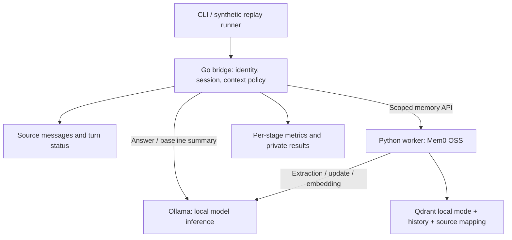

# Kyudai LLM Context Bridge

**Change the model. Carry the context. / モデルを切り替えても、文脈をつなぐ。**

[Website](https://lorendw7.github.io/kyudai-llm-context-bridge/) · [Plan](PLAN.md) · [Learning and contribution guide](CONTRIBUTING.md) · [MIT license](LICENSE)

An independent research project originating in a Kyushu University RA project. It studies context continuity when users switch language models. Laboratories may share inference capacity; their conversations, memories and permissions remain separate. This is not an official university website or endorsed service.

## Current status

**Route A selected — 2026-11-06: Go bridge + Ollama + Mem0 OSS.** The user reports supervisor approval and an existing Genkai account/allocation. The user writes all functional code; the assistant teaches and reviews in Chinese and English in chat and writes the test code and synthetic fixtures. Official documentation uses Japanese and English. The proposed course covers 16 lessons for the local research prototype and four additional lessons for Genkai, evaluation and reporting; acceptance criteria and estimates are in [PLAN.md](PLAN.md).

Implemented: a localhost-only `GET /health` endpoint, a basic `Message` record and constructor, and their Go tests. Session ownership, model switching, memory, persistence and authentication are not implemented. The website uses fixed synthetic data. No project token savings or model-quality results have been measured.

## Route A software architecture



There are three long-running processes: Go, Python and Ollama. Qdrant local mode runs inside the Python worker. All three and the replay client can run in one Genkai job. The first demonstration is a corrected fact surviving model A → B → A while another synthetic user is denied access.

| Component | Responsibility | Design reason |
| --- | --- | --- |
| Go bridge | Identity, session ownership, request IDs, model selection, context assembly, cancellation and lifecycle coordination | Application rules remain stable when inference or memory providers change |
| Context policy | Full history, rolling summary, or Mem0 plus recent messages; model-specific token budget | Makes the memory strategy an explicit experimental variable |
| Model adapter | Translate a project-owned request to an allowlisted Ollama model and normalize errors/usage | Separates model execution from session state; supports later runtime replacement |
| Python + Mem0 | Scoped ingest/search/update/delete/export, source mapping and operation status | Reuses Mem0's Python implementation behind a small contract; adds an explicit process/failure boundary |
| Storage and metrics | Keep original messages, derived memory and measurements under separate ownership | Enables provenance, reconstruction, deletion verification and honest cost accounting |

### Data and contracts

Original messages are the authoritative record. Summaries and retrieved memories are derived information; the answer context is a temporary, budgeted selection. Each source has role, message ID, owner, timestamp and schema version. Derived records retain source IDs and revision/deletion state. Assistant output must not silently become a verified user fact. Mem0 metadata alone is not assumed to guarantee provenance.

Trusted credentials resolve `lab_id` and `user_id`; clients cannot choose them in message bodies. Every operation checks session ownership, including get/update/delete by memory ID. Session scope is the default. Evaluation runs and policies use separate namespaces. Namespace filters do not replace authentication.

Proposed routes: `POST /v1/sessions`, `POST /v1/sessions/{id}/messages`, `GET /v1/sessions/{id}/export`, and `DELETE /v1/sessions/{id}`. They do not exist yet. A session fixes its context policy; each message selects an allowed answer model and request ID. Go depends on `ModelClient`, `MemoryClient`, `SessionRepository` and `TokenCounter` contracts. A versioned, authenticated local HTTP/JSON API connects Go to Python without exposing Mem0 objects.

Start with fake stores for tests, then private per-session JSON snapshots for the small single-bridge prototype. Serialize writes and test crash recovery on each platform. One Python worker owns each local memory store. This accepts limited throughput; multiple bridge instances would require a different persistence design.

### Turn flow and failures

1. Authenticate, authorize the session, validate the request/model, and save the user message.
2. Assemble context from previous committed state and the current request; reserve output space and check the exact model/tokenizer budget.
3. Generate with Ollama; save the answer and usage.
4. Complete the bounded memory/summary update before allowing the next turn; record its cost separately.

Changing answer model preserves the session, source records, memory scope and policy. Helper and embedding models stay fixed. Model caches are not conversation storage. Current explicit corrections take precedence over stale derived memory in the instruction policy, and retrieved text is treated as untrusted data; model obedience must be tested.

A saved answer with a failed memory update returns an explicit partial-failure status and blocks the next turn until reconciliation. Retrying the same request ID returns saved results when available; uncertain writes require recovery, not blind replay. Exactly-once inference is not claimed. Deletion first marks the session and advances its revision, rejects late writes, then purges source/derived stores and content-bearing checkpoints. Completion requires verification. Export and deletion cover summaries, vectors, memory history and source mappings as well as messages.

## Local configuration and evidence

Use Mem0 OSS `Memory` with explicit local generation, embedding, vector-store and history settings. Match vector dimensions. Disable telemetry before import and disable Ollama cloud features using the pinned version's supported configuration. Verify operation with outbound access denied. An embedding-only override does not establish a fully local route.

Primary sources inspected on **2026-11-06**; these are survey anchors, not an installed or fully audited distribution:

| Component | Evidence | Remaining work |
| --- | --- | --- |
| Mem0 OSS | `2.2.1`, commit `753496cf1435d76c3a711f3af51303f7fdcb6420`; [manifest](https://github.com/mem0ai/mem0/blob/753496cf1435d76c3a711f3af51303f7fdcb6420/pyproject.toml), [Apache-2.0](https://github.com/mem0ai/mem0/blob/753496cf1435d76c3a711f3af51303f7fdcb6420/LICENSE), [local LLM configuration](https://docs.mem0.ai/components/llms/models/ollama) | Resolve only needed packages, including the Ollama client; audit transitive dependencies, telemetry and artifacts |
| Ollama | commit `c1db5f9ef203b2e946161bf4c6bd4f2ec7f123b3`; [MIT](https://github.com/ollama/ollama/blob/c1db5f9ef203b2e946161bf4c6bd4f2ec7f123b3/LICENSE), [chat API](https://docs.ollama.com/api/chat), [local-only configuration](https://docs.ollama.com/faq) | Freeze binary/version/hash, bundled libraries, chat templates and supported settings |
| Qdrant client | `v1.20.0`; [Apache-2.0](https://github.com/qdrant/qdrant-client/blob/v1.20.0/LICENSE) | Verify local-mode compatibility, persistence and resolved dependencies |
| Model candidates | [Qwen3-4B](https://huggingface.co/Qwen/Qwen3-4B), [Qwen3-8B](https://huggingface.co/Qwen/Qwen3-8B), [Qwen3-Embedding-0.6B](https://huggingface.co/Qwen/Qwen3-Embedding-0.6B); publisher cards identify Apache-2.0 | Freeze model/tokenizer revisions, reasoning mode, conversion/quantization recipe and artifact hashes |

Selected application software and mandatory packages must meet the OSS requirement; no proprietary hosted service is required. NVIDIA GPU platform components have separate [vendor terms](https://docs.nvidia.com/cuda/eula/index.html). Whether institution-provided CUDA components are permitted under the project's OSS boundary remains to be confirmed; a GPU deployment is not an entirely OSS dependency chain. Retain a reviewed CPU-only route if that boundary excludes them. Installation, large downloads, paid APIs and Genkai execution need their own authorized scope.

## Genkai test design

Official documentation, accessed **2026-11-06**, describes [PJM jobs](https://www.cc.kyushu-u.ac.jp/scp/usage/job/), [GPU resource groups](https://www.cc.kyushu-u.ac.jp/scp/usage/resource_groups/) and [Singularity](https://www.cc.kyushu-u.ac.jp/scp/system/genkai/software/Singularity/). Docker cannot run directly. Verify actual account entitlement, available modules, drivers, storage and accounting before execution.

The initial proposal is one B-group GPU: a 30-minute interactive smoke test, then a development pilot capped at 60 minutes. These are resource caps, not measured runtimes. Run bridge, memory, inference and replay in one allocated compute job. Prepare reviewed artifacts beforehand; avoid runtime downloads. Services need a verified access boundary: loopback alone does not isolate other jobs on the same host, and bridge authentication does not protect a raw Ollama endpoint.

The job wrapper must check readiness, save per-case checkpoints, record failures, and stop its own children. [`PJM_SSD_DIR`](https://www.cc.kyushu-u.ac.jp/scp/usage/storage/) is temporary and removed when a job ends; save required outputs to private persistent storage throughout execution. Report queue wait, model load, generation, memory processing, peak GPU memory and allocated GPU-hours separately. Charged project points require the actual accounting rules.

## Evaluation design

Compare **full history**, **rolling summary + recent messages**, and **Mem0 + recent messages** with the same answer model, tokenizer, cases and switch schedule. Report answer-input token reduction as `1 - sum(memory input tokens) / sum(baseline input tokens)`, separately against each baseline. Record extraction, update, summary, embedding, retrieval and retry costs independently. Smaller answer context does not prove lower total cost.

The proposed dataset has 12 development and 36 distinct held-out Japanese/English cases across recall, correction, temporal order, provenance, abstention and continuation. Draft cases have 24 turns, switches after turns 8 and 16, and six scored probes. Use canonical scripted history for the paired comparison; generated-answer dialogue is a separate stress test. Three policies × three repetitions × 36 held-out cases gives 324 conversation runs. Size the final allocation from development throughput.

Proposed starting limits are 16,384 total context tokens and 512 output tokens, four recent message pairs, a 1,024-token summary, or up to five memories within 1,024 tokens. Keep the primary full-history cohort inside its context window; report overflow separately. Validate exact token counting and never silently truncate a baseline.

Proposed gates: at least 90% probe pass rate, no more than five percentage points below full history, and at least 30% fewer answer-input tokens versus full history. These are unapproved numerical proposals, not measured results. Freeze cases, source IDs, rubric, configuration and hashes before final evaluation. Report each language/family/model and paired uncertainty; preserve failures and negative savings. A separate contract suite requires zero unauthorized operations or post-deletion retrievals in the tested cases and covers restart, duplicate requests and deletion/update races.

## Run the existing scaffold

Requires Go; no model or memory dependency is needed. `go.mod` declares Go 1.25.0; Go 1.26.0 on Windows was used for the current local check.

```sh
go test ./... -v -count=1
go run ./cmd/bridge
```

`GET http://127.0.0.1:8080/health` returns `{"status":"ok","service":"context-bridge"}`. This verifies the HTTP scaffold only.

```sh
python scripts/check_repository.py
node --check website/assets/demo.js
python -m http.server 8000 --bind 127.0.0.1 --directory website
```

## Repository

| Path | Purpose |
| --- | --- |
| README.md | Current architecture and research design |
| PLAN.md | Sole action checklist, acceptance criteria and estimate |
| CONTRIBUTING.md / AGENTS.md | Learning method and collaboration rules |
| cmd/bridge/ / go.mod | User-owned Go functionality; assistant-maintained tests |
| website/ | Buildless Japanese/English project website |
| scripts/ / .github/workflows/ | Validation and GitHub Pages publication |
| LICENSE / SECURITY.md | Licensing and sensitive-data policy |

Presentation archives, generated artifacts, private data, model weights, databases and local history backups stay outside the published tree. Original project material is MIT-licensed; third-party software and model artifacts retain their own terms.

## 日本語

A案（Goブリッジ + Ollama + Mem0 OSS）を原型の実装ルートとして選択しました。現在の実装はlocalhostのhealth endpoint、基本的なMessage record／constructorとそのGoテストです。session所有権、モデル切替、記憶、永続化、認証、性能は未実装／未測定です。利用者本人が全機能コードを実装し、assistantはテストコードと合成fixtureを担当し、会話内で中国語・英語の説明とレビューを行います。ローカル原型16授業、玄界・評価・報告まで追加4授業を提案します。正式文書とサイトは日英で維持します。

Goが会話・権限・文脈組立を管理し、PythonのMem0が記憶を処理し、Ollamaが推論を実行します。原会話を正本として保持し、記憶を派生情報として出典とともに追跡します。モデルA → B → Aで訂正を保持し、別利用者からのアクセスを拒否することが最初の到達点です。玄界では1ジョブ内の構成を検証し、全履歴・逐次要約・Mem0を固定条件で比較します。大学公式サービスではありません。

週20時間の本人実装・学習を前提に、ローカルdemoは約2–3週間、玄界評価と報告まで約4–7週間（80–140時間）を見込みます。計画値であり、最初の1週間の実績で更新します。詳細な作業と受入基準は[PLAN.md](PLAN.md)、指導方法は[CONTRIBUTING.md](CONTRIBUTING.md)を参照してください。
