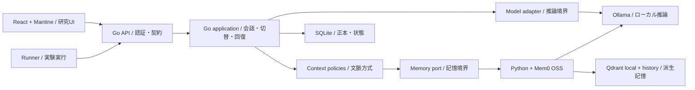

# Kyudai LLM Context Bridge

**モデルを切り替えても、文脈をつなぐ。 / Change the model. Carry the context.**

[公開サイト / Website](https://lorendw7.github.io/kyudai-llm-context-bridge/) · [作業計画 / Plan](PLAN.md) · [学習方法 / Learning guide](CONTRIBUTING.md) · [MIT](LICENSE)

九州大学RAプロジェクトに由来する独立した研究リポジトリです。LLM切替時の文脈継続、記憶の正確さ、処理負担を調べます。大学公式サイト・公認サービスではありません。共有対象は推論資源であり、会話・記憶・権限は利用者ごとに分離します。

This independent repository originates in a Kyushu University RA project. It studies context continuity, memory correctness and processing overhead when switching LLMs. It is not an official university website or endorsed service. Inference capacity may be shared; conversations, memories and permissions remain separate.

## 現在地 / Current status

2026-11-09（Asia/Tokyo）：実装済みはlocalhost限定の `GET /health`、`Session` と所有者判定、検証付き `Message` constructor、それらのGo契約testです。切替、認証、記憶、保存、実験runner、研究UIは未実装です。品質・token削減の実測結果はありません。公開サイトは固定の合成例です。

As of 2026-11-09 (Asia/Tokyo), implemented code consists of a localhost-only `GET /health`, a `Session` with ownership checks, a validated `Message` constructor and their Go contract tests. Switching, authentication, memory, persistence, the experiment runner and research UI are not implemented. No quality or token-saving results have been measured. The public website uses fixed synthetic examples.

利用者が全実装コードを書きます。対象はGo、Python、React、設定、移行、運用script、runnerです。assistantはテスト・合成fixture・test-only fake、会話内の中国語／英語による指導・レビュー、依頼された日英文書を担当します。

The user writes all implementation code: Go, Python, React, configuration, migrations, operational scripts and the runner. The assistant owns tests, synthetic fixtures and test-only fakes, provides Chinese/English teaching and review in chat, and maintains requested Japanese/English documentation.

## 読む順序 / Reading order

| 文書 / Document | 内容 / Purpose |
| --- | --- |
| [PLAN.md](PLAN.md) | 唯一の作業一覧・授業順・受入基準 / Sole action checklist, lesson sequence and acceptance gates |
| [CONTRIBUTING.md](CONTRIBUTING.md) | 一回の授業、分担、検証 / Lesson method, ownership and validation |
| [docs/architecture.md](docs/architecture.md) | 技術選定、モジュール境界、保存と更新 / Technology choices, module boundaries, persistence and upgrades |
| [docs/contracts.md](docs/contracts.md) | データ、API、失敗と再試行 / Data, API, failures and retries |
| [docs/ui.md](docs/ui.md) | React研究UI、部品ライブラリ、第三者UI / React research UI, component library and third-party clients |
| [docs/evaluation.md](docs/evaluation.md) | 比較方式、計測、玄界、報告 / Controls, metrics, Genkai and reporting |
| [docs/sources.md](docs/sources.md) | 一次資料、ライセンス、未確認事項 / Primary sources, licenses and unresolved verification |
| [AGENTS.md](AGENTS.md) / [SECURITY.md](SECURITY.md) | 協働規則・機密情報 / Collaboration and sensitive data |

文書は節ごとに日英を対応させます。識別子・コマンドは共通です。`LICENSE` は標準MIT原文を保持し、日本語の説明を[資料台帳](docs/sources.md)に置きます。進捗はPLAN.mdだけで更新します。

Documentation pairs Japanese and English within each section. Identifiers and commands are shared. `LICENSE` retains the standard MIT text; a Japanese explanation is in the [source register](docs/sources.md). Progress is tracked only in PLAN.md.

<a id="route-a-software-architecture"></a>

## 推奨構成 / Recommended architecture

選択済みのA案（Go + Ollama + Mem0 OSS）を維持し、Go内部を責務別に分けます。SQLiteによる正本保存を提案し、小型研究UIにはReact + TypeScript + Vite + Mantineを選択しました。初期版では独自CSSを書きません。導入・version固定・依存監査は未実施です。

Keep the selected Route A (Go + Ollama + Mem0 OSS) and divide the Go application by responsibility. SQLite is proposed for authoritative storage. React + TypeScript + Vite + Mantine were selected for the small research UI, with no handwritten application CSS initially. Installation, version pinning and dependency audit remain outstanding.



実行時はGo、Python、Ollamaの3プロセスを基本とします。UIの静的buildはGoが配信し、Node/Viteは開発・build時だけ使用します。Qdrant local modeはPython内で動作する提案です。UIなしでも同じAPIで評価できます。

The runtime design has three processes: Go, Python and Ollama. Go serves the UI's static build; Node/Vite are used only for development and building. Qdrant local mode is proposed inside Python. Evaluation uses the same API without the UI.

## 提供する機能 / Planned capabilities

| 範囲 / Scope | 到達点 / Outcome |
| --- | --- |
| 最初のAPI demo / First API demo | 同じsessionでA → B → A、所有者確認、明示的失敗 / A → B → A in one session, ownership checks and explicit failures |
| 記憶研究原型 / Memory prototype | 訂正・出典・検索、全履歴／要約／Mem0比較 / Corrections, provenance, search, full-history/summary/Mem0 comparison |
| 回復可能な原型 / Recoverable prototype | 再起動、重複要求、部分失敗、export/delete / Restart, duplicates, partial failures, export/delete |
| 研究UI / Research UI | 会話・モデル選択、記憶と出典、実験結果閲覧 / Conversation/model selection, memory/source inspection, result viewing |
| 評価・報告 / Evaluation and report | 固定ケース、品質・token・時間・GPU負担、日英報告 / Frozen cases, quality/tokens/time/GPU overhead, bilingual report |

一般向けSaaS、学内SSO、多人数同時運用、ファイルRAG、agent tools、商用API、fine-tuningは初期範囲外です。第三者UI互換adapterは研究UI完成後の任意拡張です。

A public SaaS, campus SSO, multi-user production operations, file RAG, agent tools, commercial APIs and fine-tuning are outside initial scope. A third-party UI adapter is an optional extension after the research UI.

## 現在のコードを確認する / Check existing code

Goが必要です。`go.mod` はGo 1.25.0を宣言し、2026-11-09にWindowsのGo 1.26.0で現在のGo test suiteの成功を確認しました。モデルやmemory packageは不要です。

Go is required. `go.mod` declares Go 1.25.0; the current Go test suite passed on Windows with Go 1.26.0 on 2026-11-09. No model or memory package is needed.

```sh
go test ./... -v -count=1
go run ./cmd/bridge
```

`GET http://127.0.0.1:8080/health` → `{"status":"ok","service":"context-bridge"}`。これはHTTP scaffoldのみの確認です。

`GET http://127.0.0.1:8080/health` → `{"status":"ok","service":"context-bridge"}`. This checks the HTTP scaffold only.

```sh
python scripts/check_repository.py
node --check website/assets/demo.js
```

依存導入、大型モデル取得、有料API、遠隔実行は許可範囲内でのみ行います。私的会話、重み、DB、実験raw出力、発表archiveは公開しません。既存 `website/` は広報用で、計画中の `web/` 研究UIとは別です。

Installation, large downloads, paid APIs and remote execution require authorized scope. Private conversations, weights, databases, raw output and presentation archives are not published. Existing `website/` is the public information site, separate from the proposed `web/` research UI.
