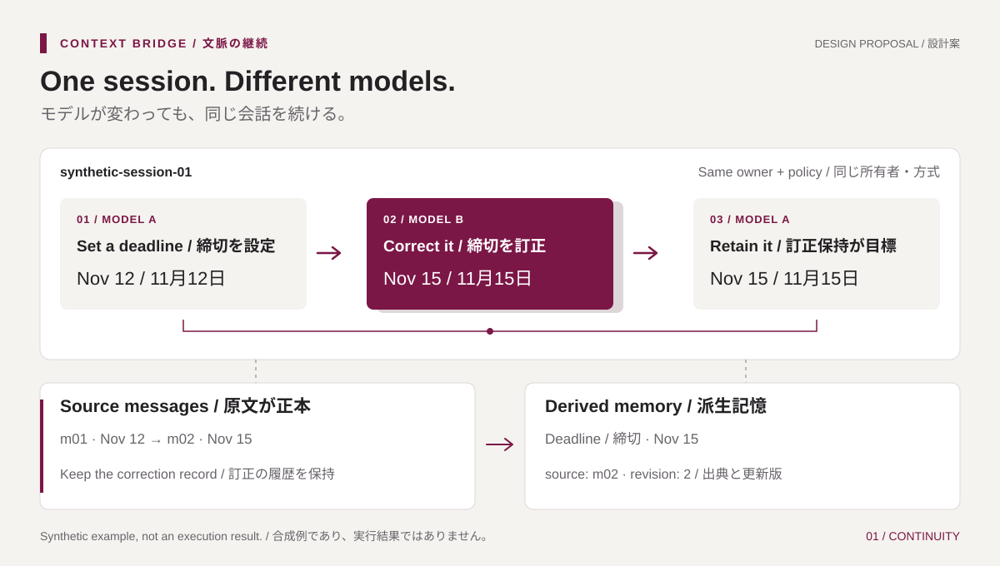

# Kyudai LLM Context Bridge

**モデルを切り替えても、文脈をつなぐ。 / Change the model. Carry the context.**

[公開サイト / Website](https://lorendw7.github.io/kyudai-llm-context-bridge/) · [作業計画 / Plan](PLAN.md) · [学習方法 / Learning guide](CONTRIBUTING.md) · [MIT](LICENSE)

九州大学RAプロジェクトに由来する独立した研究リポジトリです。LLM切替時の文脈継続、記憶の正確さ、処理負担を調べます。大学公式サイト・公認サービスではありません。共有対象は推論資源であり、会話・記憶・権限は利用者ごとに分離します。

This independent repository originates in a Kyushu University RA project. It studies context continuity, memory correctness and processing overhead when switching LLMs. It is not an official university website or endorsed service. Inference capacity may be shared; conversations, memories and permissions remain separate.

## 受入済みの範囲 / Accepted implementation

2026-11-13現在、localhost health、Session／Messageとturn request／ModelClient契約に加え、Bearer認証、所有sessionの作成・取得・一覧、許可model ID一覧、環境設定からの起動を検証済みです。sessionはmemoryのみで、応答はmetadataです。turn処理、切替、model adapter、記憶、永続保存、runner、研究UIは未受入です。品質・token削減の実測結果はありません。検証証拠・進捗は[PLAN.md](PLAN.md)を参照します。

As of 2026-11-13, verified implementation includes localhost health, Session/Message and turn-request/ModelClient contracts, Bearer authentication, owned-session creation/retrieval/listing, configured model IDs and environment-based startup. Sessions are in memory and responses contain metadata. Turn processing, switching, model adapters, memory, persistence, runner and research UI remain unaccepted. No quality or token-saving results have been measured. See [PLAN.md](PLAN.md) for verification evidence and progress.

利用者が研究機能の実装コードを書きます。対象はGo、Python、React研究UI（`web/`）、設定、移行、運用script、runnerです。assistantはテスト・合成fixture・test-only fake、会話内の中国語／英語による指導・レビュー、依頼された日英文書を担当します。2026-11-12の利用者指定により、公開サイト（`website/`）と美術素材もassistantが担当します。

The user writes research implementation code: Go, Python, the React research UI (`web/`), configuration, migrations, operational scripts and the runner. The assistant owns tests, synthetic fixtures and test-only fakes, provides Chinese/English teaching and review in chat, and maintains requested Japanese/English documentation. The user additionally assigned the public website (`website/`) and visual assets to the assistant on 2026-11-12.

## 読む順序 / Reading order

| 文書 / Document | 内容 / Purpose |
| --- | --- |
| [PLAN.md](PLAN.md) | 唯一の作業一覧・授業順・受入基準 / Sole action checklist, lesson sequence and acceptance gates |
| [CONTRIBUTING.md](CONTRIBUTING.md) | 一回の授業、分担、検証 / Lesson method, ownership and validation |
| [docs/architecture.md](docs/architecture.md) | 技術選定、モジュール境界、保存と更新 / Technology choices, module boundaries, persistence and upgrades |
| [docs/contracts.md](docs/contracts.md) | データ、API、失敗と再試行 / Data, API, failures and retries |
| [docs/ui.md](docs/ui.md) | React研究UI、部品ライブラリ、第三者UI / React research UI, component library and third-party clients |
| [docs/design.md](docs/design.md) | 視覚設計、説明用素材、公開サイトとの対応 / Visual design, explanatory assets and their public-site use |
| [docs/evaluation.md](docs/evaluation.md) | 比較方式、計測、玄界、報告 / Controls, metrics, Genkai and reporting |
| [docs/sources.md](docs/sources.md) | 一次資料、ライセンス、未確認事項 / Primary sources, licenses and unresolved verification |
| [AGENTS.md](AGENTS.md) / [SECURITY.md](SECURITY.md) | 協働規則・機密情報 / Collaboration and sensitive data |

文書は節ごとに日英を対応させます。識別子・コマンドは共通です。`LICENSE` は標準MIT原文を保持し、日本語の説明を[資料台帳](docs/sources.md)に置きます。進捗はPLAN.mdだけで更新します。

Documentation pairs Japanese and English within each section. Identifiers and commands are shared. `LICENSE` retains the standard MIT text; a Japanese explanation is in the [source register](docs/sources.md). Progress is tracked only in PLAN.md.

## 配置と責務 / Repository map

| 場所 / Location | 内容と状態 / Content and status |
| --- | --- |
| `cmd/bridge/` | 現在のGo実装と隣接test / Existing Go implementation and adjacent tests |
| `docs/` | 構成・契約・UI・評価・出典の正本文書 / Reference documents for architecture, contracts, UI, evaluation and sources |
| `website/` | 既存の公開説明サイト。固定の合成例 / Existing public information site with fixed synthetic examples |
| `website/assets/` | 公開サイトと文書で共有する説明図・サイト素材 / Explanatory artwork shared by the site and docs, plus site assets |
| `scripts/` | 既存のrepository検証 / Existing repository verification |
| `internal/`、`web/` | 未作成の提案配置。module分割とReact研究UI / Proposed, not yet created: module boundaries and the React research UI |
| `presentations/` | ignoredのlocal発表資料。stage／upload対象外 / Ignored local presentation material; excluded from staging/upload |

<a id="route-a-software-architecture"></a>

## 推奨構成 / Recommended architecture



説明用の合成図です。切替・記憶の動作や効果を実測した結果ではありません。 / This is a synthetic design illustration, not a measured demonstration of switching or memory effectiveness.

選択済みのA案はGo + Ollama + Mem0 OSSです。Goが会話・権限・切替を管理し、Python workerが記憶を扱い、Ollamaがlocal推論を提供する設計です。SQLiteによる正本保存とworker内のQdrant local modeは提案です。研究UIにはReact + TypeScript + Vite + Mantineを選択し、初期版では独自CSSを書きません。導入・version固定・依存監査は未実施です。

Selected Route A uses Go + Ollama + Mem0 OSS. The design assigns conversations, authorization and switching to Go, memory to a Python worker, and local inference to Ollama. SQLite authoritative storage and Qdrant local mode inside the worker are proposals. React + TypeScript + Vite + Mantine were selected for the research UI, with no handwritten application CSS initially. Installation, version pinning and dependency audit remain outstanding.

UIなしでも同じAPIで評価する設計です。責務・保存・回復・更新の詳細は[構成設計](docs/architecture.md)、比較条件は[評価設計](docs/evaluation.md)に集約します。

The design supports evaluation through the same API without the UI. See [architecture](docs/architecture.md) for responsibilities, persistence, recovery and upgrades, and [evaluation](docs/evaluation.md) for comparison conditions.

保守の基本は `HTTP → app → domain` の依存方向と、app側の小さなinterfaceを実装するadapterです。状態判断はapp、原子的な正本保存はSQLite adapter、派生記憶はworkerが所有します。一括分割せず、連携とtest境界が必要になった時にpackageを抽出します。研究UIは `app → features → API client → contracts` とし、公開websiteとは独立させます。

Maintainability rests on `HTTP → app → domain` dependencies and adapters implementing small app-owned interfaces. App owns state decisions, the SQLite adapter owns atomic source persistence, and the worker owns derived memory. Extract packages as integration and test boundaries require them. The research UI follows `app → features → API client → contracts` and stays separate from the public website.

## 研究範囲 / Research scope

同じsessionでのA → B → A、訂正と出典の保持、所有者の隔離、再起動・重複・部分失敗からの回復、export/deleteを扱います。全履歴・逐次要約・Mem0を固定条件で比較し、品質・token・時間・GPU負担を報告する計画です。

The planned scope covers A → B → A within one session, corrections and provenance, owner isolation, recovery from restarts/duplicates/partial failures, and export/delete. Compare full history, rolling summaries and Mem0 under frozen conditions, reporting quality, tokens, time and GPU overhead.

一般向けSaaS、学内SSO、多人数同時運用、ファイルRAG、agent tools、商用API、fine-tuningは初期範囲外です。第三者UI互換adapterは研究UI完成後の任意拡張です。

A public SaaS, campus SSO, multi-user production operations, file RAG, agent tools, commercial APIs and fine-tuning are outside initial scope. A third-party UI adapter is an optional extension after the research UI.

## 現在のコードを確認する / Check existing code

Goが必要です。go.modはGo 1.25.0を宣言し、検証環境はWindows Go 1.26.0です。model／memory packageは不要です。Python標準libraryによる起動testは合成環境設定を子processだけに渡し、一時buildとserverを後処理します。127.0.0.1:8080を空けて実行してください。

Go is required: go.mod declares Go 1.25.0; verification used Windows Go 1.26.0. No model/memory packages are needed. The Python standard-library startup test passes synthetic configuration only to child processes and cleans up its temporary build and server. Port 127.0.0.1:8080 must be free.

```sh
go test ./... -count=1
go vet ./...
go test -race ./... -count=1
python tests/test_bridge_startup.py
```

手動の `go run ./cmd/bridge` には `BRIDGE_TOKEN`、`BRIDGE_LAB_ID`、`BRIDGE_USER_ID`、`BRIDGE_MODEL_IDS` が必要です。model IDsは空白なしのcomma区切りで、空値・重複を拒否します。credentialはlocal環境で設定しcommitしません。healthだけが公開で、`/v1/` routeは `Authorization: Bearer <token>` を要求します。model一覧は設定値であり推論準備状態ではありません。

Manual `go run ./cmd/bridge` requires `BRIDGE_TOKEN`, `BRIDGE_LAB_ID`, `BRIDGE_USER_ID` and `BRIDGE_MODEL_IDS`. Model IDs are comma-separated without whitespace; empty/duplicate entries are rejected. Set credentials locally and never commit them. Only health is public; `/v1/` routes require `Authorization: Bearer <token>`. The model list represents configuration, not inference readiness.

```sh
python scripts/check_repository.py
node --check website/assets/demo.js
```

依存導入、大型モデル取得、有料API、遠隔実行は許可範囲内でのみ行います。私的会話、重み、DB、実験raw出力、発表archiveは公開しません。既存 `website/` は広報用で、計画中の `web/` 研究UIとは別です。

Installation, large downloads, paid APIs and remote execution require authorized scope. Private conversations, weights, databases, raw output and presentation archives are not published. Existing `website/` is the public information site, separate from the proposed `web/` research UI.
