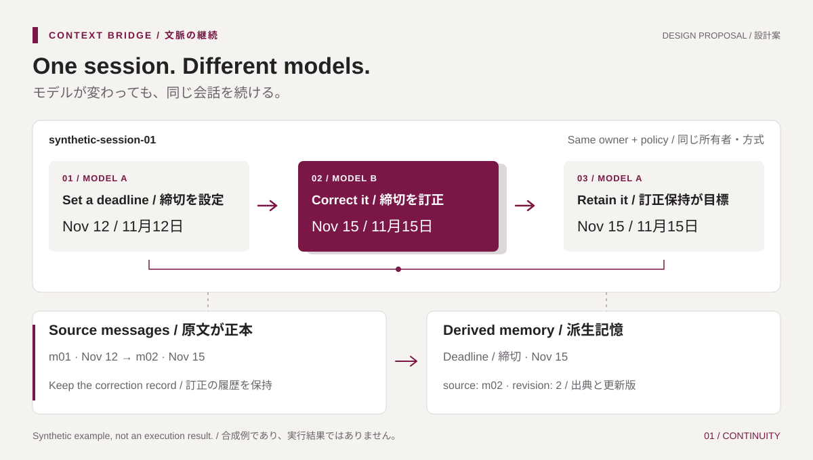

# Kyudai LLM Context Bridge

**モデルを切り替えても、文脈をつなぐ。 / Change the model. Carry the context.**

[公開サイト / Website](https://lorendw7.github.io/kyudai-llm-context-bridge/) · [作業計画 / Plan](PLAN.md) · [学習方法 / Learning guide](CONTRIBUTING.md) · [MIT](LICENSE)

九州大学RAプロジェクトに由来する独立した研究リポジトリです。LLM切替時の文脈継続、記憶の正確さ、処理負担を調べます。大学公式サイト・公認サービスではありません。共有対象は推論資源であり、会話・記憶・権限は利用者ごとに分離します。

This independent repository originates in a Kyushu University RA project. It studies context continuity, memory correctness and processing overhead when switching LLMs. It is not an official university website or endorsed service. Inference capacity may be shared; conversations, memories and permissions remain separate.

## 受入済みの範囲 / Accepted implementation

2026-11-13現在、localhost health、Session／Messageとturn request／ModelClient契約に加え、Bearer認証、所有sessionの作成・取得・一覧、許可model ID一覧、環境設定からの起動を検証済みです。sessionはmemoryのみで、応答はmetadataです。turn処理、切替、model adapter、記憶、永続保存、CLI、runner、研究UIは未受入です。2026-11-27の方針で、まず[CLI](docs/cli.md)とAPIで検証し、検証の後に研究UIを加えます。品質・token削減の実測結果はありません。検証証拠・進捗は[PLAN.md](PLAN.md)を参照します。

As of 2026-11-13, verified implementation includes localhost health, Session/Message and turn-request/ModelClient contracts, Bearer authentication, owned-session creation/retrieval/listing, configured model IDs and environment-based startup. Sessions are in memory and responses contain metadata. Turn processing, switching, model adapters, memory, persistence, the CLI, the runner and the research UI remain unaccepted. Under the 2026-11-27 direction, verification through the [CLI](docs/cli.md) and API comes first, and the research UI is added afterwards. No quality or token-saving results have been measured. See [PLAN.md](PLAN.md) for verification evidence and progress.

利用者は研究の核心codeを書きます。初めて出る型や概念はすべて本人が書きます（2026-11-27）。状態・並行実行・保存・回復・context policy・記憶の調停に加えて、HTTP handler、error envelope、middleware、認証と濫用対策、起動と停止、migrationの実行、CLI、UIの状態処理と配信が含まれます。assistantが書くのは、本人が一度書いた型の繰り返し、テスト・合成fixture・test-only fake、会話内の中国語／英語による指導・レビュー、依頼された日英文書、公開サイト（`website/`）と美術素材です。各回の担当と[核心知識の地図](PLAN.md#core-knowledge)は作業計画にあります。

The user writes the core research code, including the first instance of every pattern and concept (2026-11-27). Beyond state, concurrency, storage, recovery, context policies and memory reconciliation, this covers HTTP handlers, the error envelope, middleware, authentication and abuse control, startup and shutdown, the migration runner, the CLI, and UI state handling and serving. The assistant writes repetitions of a pattern the user has already written once, tests, synthetic fixtures and test-only fakes, Chinese/English teaching and review in chat, requested Japanese/English documentation, the public website (`website/`) and visual assets. The plan names the author of each lesson and holds the [core knowledge map](PLAN.md#core-knowledge).

<a id="product-scope"></a>

## 何ができる製品か / What the finished product lets you do

研究者がAに「締切は12日」と伝え、同じ会話でBに「15日に訂正」と伝えてから、再びAに締切を尋ねる。製品はAに渡した文脈と実際の回答を記録する。15日を答えられたかは評価の対象で、12日と答えた場合も結果に残す。

A researcher tells A the deadline is the 12th, corrects it to the 15th with B in the same conversation, then asks A for the deadline. The bridge records which sources were supplied to A and what A actually answered. An answer of “the 12th” stays in the results so the researcher can see where continuity failed.

| 想定する成果物 / Proposed delivery | 利用者ができること / User outcome | 完成を示す例 / Demonstration |
| --- | --- | --- |
| 最初のローカルAPI版 / First usable local API (S1–S2) | 全履歴で許可済みの実モデルを切り替え、回答を取得する / Switch authorized local models using full history and retrieve replies | 同じsessionでA → B → A。再起動後も保存回答が元の要求IDで返り、再送で生成が増えない / Switch A → B → A, restart, then retrieve the saved reply by its original request ID and replay without another generation |
| CLIと他のprogramから使える検証版 / Verified CLI and API version (S3–S4) | CLIだけで会話を再開し、次のモデルを選び、訂正の出典を表示し、所有sessionをexport・削除する。他の人のprogramも同じAPIを呼ぶ / Using only the CLI, resume a conversation, choose the next model, show a correction’s source, export and delete an owned session. Other people’s programs call the same API | 呼出し側ごとのtokenで会話が分かれ、安全性の回帰testが通る。これが研究UIを加える前の関門 / Conversations are separated by per-caller tokens and the security regression suite passes. This is the gate before the research UI |
| ブラウザで使える研究版 / Interactive research version (S7、検証の後 / after verification) | 日英のChat一画面で会話を再開し、次のモデルを選び、訂正の出典を開き、所有sessionをexport・削除する / Resume in one JA/EN Chat view, choose the next model, inspect a correction’s source, export and delete an owned session | Bの回答後はBを引き継ぐ。研究者は訂正元の発言を確認でき、削除完了後は会話と派生記憶を取得できない / B stays selected after its reply. The researcher can open the correction message, then verify that conversation and derived memory are inaccessible after deletion |
| 再現可能な研究評価 / Reproducible evaluation (S5–S6) | 同じ固定シナリオを全履歴・逐次要約・Mem0で再生し、品質・token・時間・GPU使用を比較する / Replay frozen scripts with full history, rolling summary and Mem0 and compare quality, tokens, time and GPU use | manifestからモデル・設定・caseを特定し、JSONL/CSVと日英報告で失敗・欠測も追跡する / Trace models, configuration and cases from the manifest through JSONL/CSV to the bilingual report, including failures and missing observations |

S1は合成モデルで通信・履歴・失敗を検証する段階です。実モデルの利用には配布物・依存の監査と実行許可が必要です。各段階の受入は[作業計画](PLAN.md#teaching-route)にあります。

S1 exercises transport, history and failures with synthetic models. Real-model use depends on artifact and dependency review and execution authorization. See the [plan](PLAN.md#teaching-route) for each stage’s acceptance criteria.

## 読む順序 / Reading order

L3の続きは[Bの回答をいつ「保存済み」と表示できるか](CONTRIBUTING.md#l4-state-lesson)の一問から始めます。今回書くコードと受入条件は[L4の作業計画](PLAN.md#l4-entry)にあります。 / To resume after L3, start with [When can B’s reply appear as saved?](CONTRIBUTING.md#l4-state-lesson). The [L4 plan](PLAN.md#l4-entry) defines the first code change and when to stop.

| 文書 / Document | 内容 / Purpose |
| --- | --- |
| [PLAN.md](PLAN.md) | 唯一の作業一覧・段階課題・受入基準 / Sole action checklist, stage projects and acceptance gates |
| [CONTRIBUTING.md](CONTRIBUTING.md) | 一回の授業、分担、検証 / Lesson method, ownership and validation |
| [docs/architecture.md](docs/architecture.md) | 技術選定、モジュール境界、安全設計、保存と更新 / Technology choices, module boundaries, security design, persistence and upgrades |
| [docs/contracts.md](docs/contracts.md) | データ、API、失敗と再試行 / Data, API, failures and retries |
| [docs/cli.md](docs/cli.md) | CLIのcommand、送信と回復、出力と終了code / CLI commands, sending and recovery, output and exit codes |
| [docs/ui.md](docs/ui.md) | 検証の後に加えるReact研究UI、browserの安全対策、第三者UI / React research UI added after verification, browser security and third-party clients |
| [docs/design.md](docs/design.md) | 視覚設計、説明用素材、公開サイトとの対応 / Visual design, explanatory assets and their public-site use |
| [docs/evaluation.md](docs/evaluation.md) | 比較方式、計測、玄界、報告 / Controls, metrics, Genkai and reporting |
| [docs/sources.md](docs/sources.md) | 一次資料、ライセンス、未確認事項 / Primary sources, licenses and unresolved verification |
| [AGENTS.md](AGENTS.md) / [SECURITY.md](SECURITY.md) | 協働規則・機密情報 / Collaboration and sensitive data |

文書は節ごとに日英を対応させます。識別子・コマンドは共通です。`LICENSE` は標準MIT原文を保持し、日本語の説明を[資料台帳](docs/sources.md)に置きます。進捗はPLAN.mdだけで更新します。

Documentation pairs Japanese and English within each section. Identifiers and commands are shared. `LICENSE` retains the standard MIT text; a Japanese explanation is in the [source register](docs/sources.md). Progress is tracked only in PLAN.md.

## 配置と責務 / Repository map

| 場所 / Location | 内容と状態 / Content and status |
| --- | --- |
| `cmd/bridge/` | 現在のGo実装と隣接test / Existing Go implementation and adjacent tests |
| `docs/` | 構成・契約・UI・評価・出典の正本文書 / Reference documents for architecture, contracts, UI, evaluation and sources |
| `website/` | 既存の公開説明サイト。固定の合成例 / Existing public information site with fixed synthetic examples |
| `website/assets/` | 公開サイトと文書で共有する説明図・サイト素材 / Explanatory artwork shared by the site and docs, plus site assets |
| `scripts/` | 既存のrepository検証 / Existing repository verification |
| `internal/`、`web/` | 未作成の提案配置。module分割、CLIとrunnerが共有するclient、検証後のReact研究UI / Proposed, not yet created: module boundaries, the client shared by the CLI and runner, and the React research UI after verification |
| `presentations/` | ignoredのlocal発表資料。stage／upload対象外 / Ignored local presentation material; excluded from staging/upload |

<a id="route-a-software-architecture"></a>

## 推奨構成 / Recommended architecture



説明用の合成図です。切替・記憶の動作や効果を実測した結果ではありません。 / This is a synthetic design illustration, not a measured demonstration of switching or memory effectiveness.

選択済みのA案はGo + Ollama + Mem0 OSSです。Goが会話・権限・切替を管理し、Python workerが記憶を扱い、Ollamaがlocal推論を提供する設計です。SQLiteによる正本保存とworker内のQdrant local modeは提案です。人と他のprogramはまずCLIと `/v1` のAPIを使います。研究UIにはReact + TypeScript + Vite + Mantineを選択済みで、CLIとAPIの検証が終わってから加えます（2026-11-27）。初期版では独自CSSを書きません。導入・version固定・依存監査は未実施です。防御は層ごとに置き、各対策にtestを付けます。一覧は[安全設計](docs/architecture.md#security)にあります。

Selected Route A uses Go + Ollama + Mem0 OSS. The design assigns conversations, authorization and switching to Go, memory to a Python worker, and local inference to Ollama. SQLite authoritative storage and Qdrant local mode inside the worker are proposals. People and other programs first use the CLI and the `/v1` API. React + TypeScript + Vite + Mantine are selected for the research UI, which is added once the CLI and API are verified (2026-11-27), with no handwritten application CSS initially. Installation, version pinning and dependency audit remain outstanding. Defenses are layered, each with a test; the [security design](docs/architecture.md#security) lists them.

UIなしでも同じAPIで評価する設計です。責務・保存・回復・更新の詳細は[構成設計](docs/architecture.md)、比較条件は[評価設計](docs/evaluation.md)に集約します。

The design supports evaluation through the same API without the UI. See [architecture](docs/architecture.md) for responsibilities, persistence, recovery and upgrades, and [evaluation](docs/evaluation.md) for comparison conditions.

保守の基本は `HTTP → app → domain` の依存方向と、app側の小さなinterfaceを実装するadapterです。状態判断はapp、原子的な正本保存はSQLite adapter、派生記憶はworkerが所有します。一括分割せず、連携とtest境界が必要になった時にpackageを抽出します。CLIとrunnerは同じGoの `client` を使います。研究UIは `app → features → API client → contracts` とし、公開websiteとは独立させます。

Maintainability rests on `HTTP → app → domain` dependencies and adapters implementing small app-owned interfaces. App owns state decisions, the SQLite adapter owns atomic source persistence, and the worker owns derived memory. Extract packages as integration and test boundaries require them. The CLI and runner share one Go `client`. The research UI follows `app → features → API client → contracts` and stays separate from the public website.

## 研究範囲 / Research scope

一般向けSaaS、学内SSO、多人数同時運用、ファイルRAG、agent tools、商用API、fine-tuningは初期範囲外です。第三者UI互換adapterは研究UI完成後の任意拡張です。

A public SaaS, campus SSO, multi-user production operations, file RAG, agent tools, commercial APIs and fine-tuning are outside initial scope. A third-party UI adapter is an optional extension after the research UI.

## 現在のコードを確認する / Check existing code

Goが必要です。go.modはGo 1.25.0を宣言し、検証環境はWindows Go 1.26.0です。model／memory packageは不要です。Python標準libraryによる起動testは合成環境設定を子processだけに渡し、一時buildとserverを後処理します。127.0.0.1:8080を空けて実行してください。

Go is required: go.mod declares Go 1.25.0; verification used Windows Go 1.26.0. No model/memory packages are needed. The Python standard-library startup test passes synthetic configuration only to child processes and cleans up its temporary build and server. Port 127.0.0.1:8080 must be free.

```sh
go test ./... -count=1
go vet ./...
go test -race ./... -count=1
python tests/test_bridge_startup.py
```

手動の `go run ./cmd/bridge` には `BRIDGE_TOKEN`、`BRIDGE_LAB_ID`、`BRIDGE_USER_ID`、`BRIDGE_MODEL_IDS` が必要です。model IDsは空白なしのcomma区切りで、空値・重複を拒否します。任意の `BRIDGE_LISTEN_ADDRESS` はloopback IPの `host:port` で、未設定なら `127.0.0.1:8080` です。Ctrl+Cで受付を止め、進行中の要求を待ってから終了します。credentialはlocal環境で設定しcommitしません。healthだけが公開で、`/v1/` routeは `Authorization: Bearer <token>` を要求します。model一覧は設定値であり推論準備状態ではありません。

Manual `go run ./cmd/bridge` requires `BRIDGE_TOKEN`, `BRIDGE_LAB_ID`, `BRIDGE_USER_ID` and `BRIDGE_MODEL_IDS`. Model IDs are comma-separated without whitespace; empty/duplicate entries are rejected. Optional `BRIDGE_LISTEN_ADDRESS` is a loopback-IP `host:port`, defaulting to `127.0.0.1:8080`. Ctrl+C stops accepting, waits for in-flight requests and exits. Set credentials locally and never commit them. Only health is public; `/v1/` routes require `Authorization: Bearer <token>`. The model list represents configuration, not inference readiness.

```sh
python scripts/check_repository.py
node --check website/assets/demo.js
```

依存導入、大型モデル取得、有料API、遠隔実行は許可範囲内でのみ行います。私的会話、重み、DB、実験raw出力、発表archiveは公開しません。既存 `website/` は広報用で、計画中の `web/` 研究UIとは別です。

Installation, large downloads, paid APIs and remote execution require authorized scope. Private conversations, weights, databases, raw output and presentation archives are not published. Existing `website/` is the public information site, separate from the proposed `web/` research UI.
