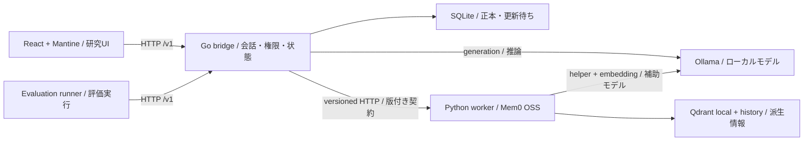

# ADR-001: 保守可能な研究原型 / Maintainable research prototype

更新 / Updated: 2026-11-12。状態 / Status: A案とMantineは選択済み。2026-11-10受入のdomain契約、versioned turn DTO、project固有の `ModelClient` interfaceを出発点に、以下のpackage分割・adapter・保存・UI境界を設計提案として整理します。 / Route A and Mantine are selected. Starting from the domain contracts, versioned turn DTO and project-owned `ModelClient` interface accepted on 2026-11-10, the package split, adapters, persistence and UI boundaries below remain design proposals.

決定者は利用者です。実装と導入は別途の受入・許可範囲に従います。進捗は[PLAN.md](../PLAN.md)のみで管理します。

The user is the decision maker. Implementation and installation follow their acceptance and authorized scope. Track progress only in [PLAN.md](../PLAN.md).

今回の結論は、Goを一つのapplicationとして維持し、外部I/Oをadapterで隔離する構成です。新しいpackageは独立した変更理由・実際の依存・test境界が生まれた時に追加します。研究機能codeの移動や実装は本人が担当し、今回の整理で実施済みとはしません。

The proposal keeps Go as one application and isolates external I/O behind adapters. Add a package when an independent reason to change, a real dependency or a useful test boundary appears. The user owns research-code extraction and implementation; this design revision does not claim that work is done.

## 目的と選択肢 / Context and options

一人が学びながら保守し、Windowsで開発し、許可後に玄界で再現実験を行う原型です。主題はモデル変更時の文脈と記憶であり、新しい推論engineの開発ではありません。既存OSSを再利用し、交換箇所を限定します。根拠は[資料台帳](sources.md)に集約します。

One learner maintains the prototype, develops on Windows and later runs authorized reproducible experiments on Genkai. The research concerns context and memory during model changes, not a new inference engine. Reuse existing OSS and confine replacement points. Evidence is in the [source register](sources.md).

| 選択肢 / Option | 利点 / Benefit | 負担・判断 / Cost and decision |
| --- | --- | --- |
| Go一体型application + Python worker / Modular Go application + Python worker | Go学習とMem0再利用を両立 / Keeps Go learning and Mem0 reuse | HTTP境界を1つ維持。推奨 / One worker HTTP boundary; recommended |
| Python単一application / Python-only application | processと型変換が少ない / Fewer processes and translations | Go学習・選択済みA案から外れる / Departs from Go learning and selected Route A |
| 多数のmicroservices / Many microservices | 個別scale / Independent scaling | 配布、認証、障害処理が増える。現段階では不要 / More deployment, auth and failure handling; unnecessary now |
| 完成chat製品のfork / Fork a complete chat product | 画面を再利用 / Reuses a UI | 独自session・記憶・更新の責務が衝突 / Competing session/memory ownership and upgrade burden |

## 技術スタック / Technology stack

| 層 / Layer | 推奨 / Recommendation | 固定・交換条件 / Pinning and replacement |
| --- | --- | --- |
| Application | Go、標準 `net/http`, `encoding/json`, `context`, `database/sql` / Go standard packages | 現在の `go.mod` を出発点にし、ORM・web frameworkを初期追加しない / Start from current go.mod; no initial ORM/web framework |
| 正本保存 / Authoritative storage | SQLite、driver候補 `modernc.org/sqlite` / SQLite with modernc.org/sqlite candidate | Go対応・推移依存・LICENSEを確認後に固定 / Pin after Go compatibility, dependency and license review |
| 推論 / Inference | Ollama HTTP adapter | 特定model API型をapplicationへ流さない / Keep provider types out of application |
| 記憶 / Memory | Python worker + Mem0 OSS `Memory` | `MemoryClient`はcloud版ではない。local設定を明示 / Do not use the cloud client; configure all local providers explicitly |
| 派生保存 / Derived storage | Qdrant local mode + Mem0 history + source mapping | workerが単独所有。正本DBと別ファイル / One worker owns these; separate from source DB |
| UI | React + TypeScript + Vite + Mantine（選択済み） / React + TypeScript + Vite + Mantine (selected) | library stylesとtheme props。自作CSSなし / Library styles and theme props; no custom CSS |
| 検証 / Verification | Go testing、Python unittest；UIにVitest + Testing Library、E2EにPlaywrightを候補 / Go testing, Python unittest; proposed Vitest/Testing Library and Playwright | 現在はGo検証のみ導入済み。追加test依存も監査・導入許可対象 / Only current Go checks exist; new test dependencies also require audit and installation scope |
| 実験 / Experiments | Go runner、JSONL/CSV metrics、versioned JSON設定 / Go runner, JSONL/CSV metrics, versioned JSON config | runnerから同じAPIを呼び、UIに依存しない / Use the same API independently of UI |

SQLiteをJSON snapshotより推奨する理由は、message・turn・request ID・更新待ち記録をtransactionで一緒に保存できることです。DB driver追加とschema migrationの学習は必要です。最初の契約演習はメモリ内repositoryで行い、その実装も本人が担当します。test-only fakeだけをassistantが実装します。

SQLite is preferred over JSON snapshots because messages, turns, request IDs and pending updates can be stored together transactionally. It adds a driver and schema-migration learning. Initial contract exercises use a user-written in-memory repository; only test-only fakes are assistant-owned.

## 実行時の境界 / Runtime boundaries

これは予定のruntime呼出し図で、Goのimport図ではありません。基本はGo・Python worker・Ollamaの3 processです。Goが研究UIの静的buildを配信し、Node/Viteは開発・build時に使います。runnerは必要時だけ起動し、同じnative APIを呼びます。公開 `website/` は別の説明用siteで、研究APIやDBに接続しません。

This is a proposed runtime-call diagram, not a Go import graph. The core has three processes: Go, the Python worker and Ollama. Go serves the research UI's static build; Node/Vite are development/build tools. The runner starts only when needed and uses the same native API. Public `website/` is a separate information site without access to the research API or databases.

## モジュール境界と依存規則 / Module boundaries and dependency rules

すべて以下は予定構成です。現コードを自動移動・書換えしません。小さい間はpackageを増やしすぎず、利用側に小さなinterfaceを定義します。application/domainはHTTP、SQLite、Mem0、Reactに依存しません。

Everything below is a target structure. Existing code is not automatically moved or rewritten. Keep packages modest and define small interfaces at their consumers. Application/domain code must not depend on HTTP, SQLite, Mem0 or React.

| Module / 予定場所 | 責務と境界 / Responsibility and boundary | 変更・検証の接点 / Change and test boundary |
| --- | --- | --- |
| Domain / `internal/domain` | Session、Message、Turn、Principal/Scopeの値と不変条件。外部I/Oなし / Core values and invariants, including identity/scope; no external I/O | 純粋な所有権・role・状態規則のunit tests / Pure ownership, role and state-rule unit tests |
| Application / `internal/app` | session、turn、回復、export/deleteのuse caseと消費側port。state変更を決定 / Use cases and consumer-owned ports; decides state transitions | session/turn/recovery/data操作をまず同packageの別fileに分け、fakeで検証 / Separate responsibility files within one package first; test with fakes |
| HTTP / `internal/transport/httpapi` | versioned DTO、認証結果の受渡し、入力制限、HTTP error変換、UI配信 / Versioned DTOs, authenticated identity forwarding, input limits, HTTP error mapping and UI serving | domain/use-case型との境界mapping。認可判断をhandlerに重複させない / Boundary mapping; do not duplicate use-case authorization in handlers |
| Adapters / `internal/adapters/{ollama,sqlite,memoryhttp}` | 外部の推論・正本保存・worker通信をそれぞれ隔離 / Isolate inference, source persistence and worker communication separately | 実際の連携時に作成。provider応答、短transaction、timeout・errorの契約 / Create with real integrations; provider responses, short transactions and timeout/error contracts |
| Worker / `memory-worker` | Python内でAPI境界、operation調整、Mem0依存、派生store所有を分ける / Separate API handling, operation coordination, Mem0 dependency and derived-store ownership inside Python | HTTP handlerから直接storeを触らない。source mapping、重複、訂正、削除を検証 / Handlers do not manipulate stores directly; test mapping, duplicates, corrections and deletion |
| UI / `web/src` | appが認証・session・画面間連携を所有。featuresが表示と操作を担当 / App owns auth/session/cross-view coordination; features own views and interaction | `app → features → lib/api → lib/contracts`。詳細は[UI設計](ui.md) / See UI design for dependency and test seams |
| Runner / `cmd/evaluate` | frozen case/config、API再生、checkpoint、結果集計 / Frozen input, API replay, checkpoints and aggregation | native APIだけを利用し、DBやmemoryへ直接書込まない / Use only the native API; never write directly to DB or memory |
| Composition / `cmd/bridge` | 設定検証、具体adapterの生成・注入、起動・readiness・停止 / Validate config, construct/inject concrete adapters, start, report readiness and stop | 構築と終了だけを調整し、会話のbusiness ruleを置かない / Coordinate construction/lifecycle without conversation business rules |

port候補は `ModelClient`, `MemoryClient`, `SessionRepository`, `ContextPolicy`, `TokenCounter`, `MetricsSink`。domain値とproject固有のuse-case入出力型を使い、vendor SDK objectを返しません。現在のuse caseが必要なportだけを導入します。UIはversioned DTOのみを参照します。契約の詳細は[contracts.md](contracts.md)です。

Candidate ports are ModelClient, MemoryClient, SessionRepository, ContextPolicy, TokenCounter and MetricsSink. They use domain values and project-owned use-case input/output types, not vendor SDK objects. Introduce only the ports a current use case needs. The UI consumes versioned DTOs only. See [contracts.md](contracts.md).

Goの依存方向は `httpapi → app → domain` と `adapters → app/domain` です。`cmd/bridge` だけが具体adapterとuse caseを組み立てます。domainは他のproject layerをimportせず、appはHTTP DTO・SQL driver・Ollama/Mem0型をimportしません。app側が必要最小限のinterfaceを定義し、adapterが実装します。大きな共通 `ports`／`utils` packageへ型を集めません。

Go dependencies point `httpapi → app → domain` and `adapters → app/domain`. Only `cmd/bridge` wires concrete adapters into use cases. Domain imports no other project layer; app imports no HTTP DTOs, SQL drivers or Ollama/Mem0 types. App defines the small interfaces it consumes and adapters implement them. Do not collect every type into broad `ports` or `utils` packages.

credential→Principalの検証はHTTP境界の責務、Principalと対象sessionの認可はuse caseの責務です。認証providerが独立して変化するときだけ `internal/auth` に抽出します。policy・token予算・metricsは初めはapp内の小さい部品でよく、独立した実装が必要になった時に `internal/contextpolicy` 等へ抽出し、appへ注入します。appと実装packageが互いをimportする構成にしません。

Credential-to-Principal verification belongs at the HTTP boundary; authorization of that Principal for the target session belongs in the use case. Extract `internal/auth` when authentication providers need to change independently. Policies, token budgets and metrics can begin as small app-local components. Extract packages such as `internal/contextpolicy` when independent implementations are needed, then inject them into app. Avoid app/implementation import cycles.

### 段階的な抽出 / Incremental extraction

以下は[PLAN.md](../PLAN.md)の段階との対応であり、追加の作業一覧ではありません。空directoryや全interfaceを先に作らず、一つの責務を抽出するたびに既存契約・失敗動作を維持して確認します。

This maps to the stages in [PLAN.md](../PLAN.md), not a second task list. Do not pre-create empty directories or every interface. Extract one responsibility at a time and verify that existing contracts and failure behavior stay intact.

| 段階 / Stage | 分離する理由と範囲 / Reason and scope |
| --- | --- |
| S1 | 契約とHTTP処理が安定した時にdomain/app/httpapiを順に抽出。現在の学習codeを一括移動しない / Extract domain/app/httpapi as contracts and HTTP behavior stabilize; no bulk relocation of learning code |
| S2 | 実Ollama・SQLite接続が出現した時にadapterを追加。保存の原子操作を先に定義 / Add adapters with actual Ollama/SQLite integrations; define atomic storage operations first |
| S3 | worker境界と3方式の違いが出現した時にmemory adapterとpolicyを分離 / Separate the memory adapter and policies when worker integration and three distinct policies exist |
| S4–S5 | webとrunnerをnative API上に構築。必要な計測を追加し、再利用と独立更新の必要がある部分だけ抽出 / Build web and runner on the native API; add metrics and extract only for real reuse or independent updates |

## データと失敗 / Data and failures

原messageを正本とします。summary、memory、vector、browser表示は派生情報です。memoryはsource IDs、revision、抽出versionを持ち、assistant回答を検証済み事実へ自動昇格しません。modelを切り替えてもsession ID、owner、policy、sourceは維持し、helper/embedding modelは実験内で固定します。

Source messages are authoritative. Summaries, memories, vectors and browser views are derived. Memory retains source IDs, revision and extraction version; assistant output is not automatically promoted to a verified fact. Switching models preserves session ID, owner, policy and sources; helper/embedding models stay fixed within an experiment.

| 所有者 / Owner | 決定・保存する内容 / Decisions and persisted content |
| --- | --- |
| Go app | session/turnの状態遷移、認可、policy/model選択、回復判断 / Session/turn transitions, authorization, policy/model selection and recovery decisions |
| SQLite adapter | 正本message、turn、重複key、更新待ち記録を原子的に保存。制約を実施 / Atomically persist authoritative messages, turns, deduplication keys and pending work; enforce constraints |
| Python worker | 派生記憶、vector、history、出典mapping、worker operation結果。Goのturnを直接更新しない / Derived memory/vectors/history/provenance and worker-operation results; never directly mutate Go turns |
| UI / runner | APIから受け取ったsnapshotと操作意図。正本や権限を独自決定しない / API snapshots and user/run intent, without independently defining authority or access |

1. 認証・所有者確認後、request ID／payload、user message、初期turn状態を短transactionで保存し、同sessionのactive turnが一つという制約を守る。 / After authentication/authorization, atomically persist request identity/payload, user message and initial turn state while enforcing one active turn per session.
2. transactionを閉じてcontext組立・推論を行う。answer、usage、派生更新が必要な場合の更新意図を別の短transactionで保存する。 / Close the transaction before context construction/inference. Atomically save the answer, usage and, when needed, derived-update intent in a separate short transaction.
3. transaction外でworkerへ更新を要求し、結果を照合してGoが完了を保存する。派生更新不要のpolicyは直接完了する。 / Request the worker update outside a transaction; Go reconciles the result and records completion. Policies without derived updates complete directly.

Repository portは上記の原子操作を表現します。一般的なCRUDの寄せ集めでuse caseに途中状態を組み立てさせず、SQL transactionやdriver型をappへ公開しません。revisionの意味・増分主体・削除後の遅延write拒否は[契約設計](contracts.md)に集約します。

The repository port expresses these atomic operations. Avoid generic CRUD that forces use cases to assemble partially committed state; expose neither SQL transactions nor driver types to app. Revision meanings, increment owners and rejection of writes after deletion are defined in [contracts.md](contracts.md).

Go側も、要求受理・回答保存・回復完了の各transactionで、sessionが `deleting/deleted` でなく、operation開始時の `session_epoch` と一致することを原子的に確認します。不一致なら正本への書込を拒否します。worker側の検査だけに依存せず、削除後に遅い推論回答が正本へ戻る経路を閉じます。

Go also atomically checks, inside request-acceptance, answer-save and recovery-completion transactions, that the session is neither deleting nor deleted and its `session_epoch` matches the operation's starting epoch. Reject source writes on mismatch. Worker checks alone are insufficient: a late inference result must not recreate authoritative content after deletion.

正本DBとQdrantは同じtransactionにはできません。追加queue serviceは使わず、DBの更新待ち記録を再調停します。answer保存後のmemory失敗は `memory_pending` として可視化し、回復まで次turnを止めます。不確定な推論・writeを無条件に再送せず、exactly-once inferenceは主張しません。

The source DB and Qdrant cannot share a transaction. Reconcile pending DB operations without adding a queue service. A memory failure after answer persistence becomes visible as memory_pending and blocks the next turn until recovery. Do not blindly retry uncertain inference/writes or claim exactly-once inference.

sessionごとに同時実行は1turn、最初のGPU実行も直列です。削除開始時に `session_epoch` を進め、遅延writeを拒否し、全派生store・content-bearing checkpointを削除して検証します。削除APIは物理媒体の完全消去を保証しません。

Allow one active turn per session and initially serialize GPU work. Deletion advances `session_epoch`, rejects late writes, purges all derived stores/content-bearing checkpoints and verifies completion. The deletion API does not promise physical-media erasure.

### 実行の寿命 / Execution lifecycle

202を返す前に受理状態を永続化します。appが同じGo process内の有界な実行・回復を管理し、HTTP handlerが所有者不明のgoroutineを要求ごとに放置しません。受理済みjobはHTTP切断で取消にならず、明示cancel APIを使います。起動時は受理済み・更新待ち記録を照合し、不確定な推論は `recovery_required` として可視化します。再起動後の無条件再生成は行いません。

Persist acceptance before returning 202. App owns bounded execution and recovery inside the Go process; HTTP handlers must not leave unmanaged per-request goroutines. Disconnecting HTTP does not cancel accepted work; cancellation uses the explicit API. Startup reconciles accepted/pending records and exposes uncertain inference as `recovery_required`, without blind regeneration after restart.

永続化前のS1のin-memory演習ではprocess内の状態遷移だけを検証し、再起動回復は主張しません。上記の耐久性はS2の正本保存受入後に検証します。

Before persistence, S1 in-memory exercises verify process-local transitions without claiming restart recovery. Verify the durability above only after authoritative storage is accepted in S2.

組立入口がprocessの停止signalと期限を渡し、まず新しい受理を止め、進行中処理を確定または回復可能な状態にしてから接続を閉じます。workerもoperation状態を記録します。process自身が起動していないOllama等を暗黙停止しません。livenessと依存readinessを区別し、具体的な期限・上限は実装時に設定契約で固定します。

The composition root supplies shutdown signals/deadlines: stop new acceptance, settle active work or preserve recoverable state, then close resources. The worker records operation state too. Do not implicitly terminate an Ollama process that this process did not start. Separate liveness from dependency readiness; freeze actual deadlines and bounds in the implementation's configuration contract.

## 更新と回復の設計 / Upgrade and recovery design

| 変更 / Change | 安定境界 / Stable boundary | 移行・戻し方 / Migration and rollback |
| --- | --- | --- |
| React/Mantine/Vite | native `/v1` DTO | lockfile、build ID、直前のUI artifactを保持。API互換テスト / Lockfile/build ID, retain previous UI artifact, API contract tests |
| Go内部 / Go internals | domain invariants、ports、API | package単位で変更、unit/contract回帰 / Change by package; unit/contract regression |
| API/worker | `/v1`、`schema_version`、capability情報 / Version and capability information | 旧consumerが無視できる任意response fieldだけを互換追加とする。必須field・enum・意味変更は互換性判定とversion移行 / Only optional response fields older consumers can ignore are compatible additions; required fields, enums and semantics require compatibility review and version migration |
| SQLite schema | repository port | migration IDとbackup。private copyで移行・restore検証後に適用 / Migration IDs/backups; test migration/restore on private copies before use |
| Mem0/Qdrant | worker contract | 新しいnamespace/storeへ再構築して比較。旧storeを直接書換えない / Rebuild into a new namespace/store and compare; do not overwrite the old store directly |
| embedding model/dimension | source IDsとmemory schema / Source IDs and memory schema | vector再生成、新collection、切替前照合 / Re-embed into a new collection and verify before switching |
| answer/helper model | model adapter | weights/tokenizer/template/quantization/hashを固定。新しい実験ID / Pin weights/tokenizer/template/quantization/hashes; use a new experiment ID |
| inference runtime | ModelClient/TokenCounter | capability・usage・timeout・token対応を実測確認 / Verify capabilities, usage, timeouts and token accounting |

一度に一つの依存系統を更新し、productionとtest依存をlockします。前版manifest、artifact、移行前backupを私的に保持し、schema互換性を確認せず古いbinaryを新DBへ戻しません。prototype段階では停止時間を許容し、zero-downtime移行は要求しません。

Upgrade one dependency family at a time and lock production/test dependencies. Retain the previous manifest, artifacts and pre-migration backup privately. Never run an old binary against a new DB without schema compatibility. Prototype upgrades may use downtime; zero-downtime migration is not required.

削除済みデータをbackupから復活させないため、restore時も削除台帳を適用します。backup、WAL、exportの保持・削除範囲を文書化します。Genkaiではlocal storageとprivate永続storageを区別し、共有filesystem上のlive SQLite/WALを前提にしません。

Apply the deletion ledger during restore to avoid resurrecting deleted data. Document retention/deletion of backups, WAL and exports. On Genkai, distinguish local storage from private persistent storage; do not assume live SQLite/WAL is safe on a shared filesystem.

## 変更の範囲と検証 / Change scope and verification

| 変更例 / Change example | 主に変更する場所 / Primary change location | 受入証拠 / Acceptance evidence |
| --- | --- | --- |
| 推論providerの応答形式 / Provider response shape | Ollama adapterと対応fixture / Adapter and corresponding fixtures | ModelClient契約、usage欠測、timeout・取消 / ModelClient contract, missing usage, timeout/cancellation |
| 訂正・turn回復の規則 / Correction or recovery rule | domain/appと契約正本 / Domain/app and contract reference | 同じ合成入力で状態・重複・回復の回帰 / State, duplicate and recovery regression with the same synthetic inputs |
| Mem0更新 / Mem0 upgrade | Worker内部、依存lock、必要ならworker protocol / Worker internals, locks and protocol only if necessary | 出典、scope隔離、削除、operation replay / Provenance, scope isolation, deletion and replay |
| UI library更新 / UI library upgrade | webのview・provider設定とlock / Web views/provider setup and locks | DTO境界を保ったkeyboard、IME、狭幅、削除後cache検証 / Stable DTO boundaries plus keyboard, IME, narrow layout and deletion-cache checks |
| DB schema変更 / DB schema change | SQLite adapterとmigration / Adapter and migration | 前版snapshotからの移行・restore、整合制約 / Migration/restore from the prior snapshot and integrity constraints |

package数ではなく、変更理由が一か所に収まり、外部依存をfakeへ置換でき、失敗の意味が境界で維持されることを保守性の基準にします。新しい抽象化には実際の利用者を必要とし、共通wrapper・plugin機構・event busを先に作りません。構造reviewではimport循環・vendor型の漏出・正本への二重書込を確認します。

Maintainability means one place for a reason to change, replaceable external dependencies and preserved failure semantics across boundaries, rather than a larger package count. Require actual consumers for new abstractions; do not prebuild wrapper libraries, plugin systems or event buses. Structure review checks import cycles, leaking vendor types and multiple writers to authoritative data.

利点はprovider・store・UI更新の影響を閉じ込められることです。一方、境界のDTO変換、fake契約の維持、Go/worker間の部分失敗処理は必要になります。初期版では短い明示的なmappingと少数の契約fixtureを優先し、code generation基盤は契約が安定してから再検討します。

This limits the impact of provider, storage and UI changes. The cost is explicit DTO mapping, maintaining fake contracts and handling partial failures between Go and the worker. Initially favor small explicit mappings and a few meaningful contract fixtures; reconsider code generation only after contracts stabilize.

## 見直す条件 / Revisit triggers

multi-process書込、複数worker、常時サービスが必要になればPostgreSQLやQdrant serverを別ADRで検討します。Ollamaの能力・throughputが実測で不足すればllama.cpp/vLLM adapterを別実験にします。Mem0とモデルを同じ種類の代替物として比較しません。

If multi-process writers, multiple workers or a persistent service become necessary, consider PostgreSQL/Qdrant server in a separate ADR. If measured capabilities/throughput are insufficient, evaluate a llama.cpp/vLLM adapter separately. Do not compare Mem0 and a model as interchangeable alternatives.
