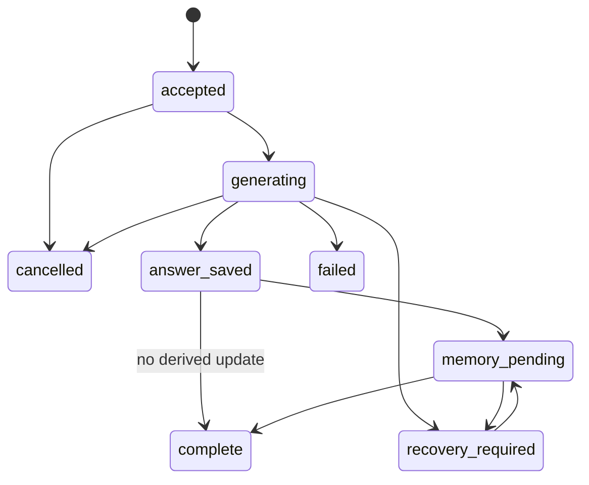

# 契約設計 / Contract design

更新 / Updated: 2026-11-12。2026-11-10までの受入済み範囲は `GET /health`、`Session`／`Message` domain契約、version 1の `CreateTurnRequest` と `ModelClient` interfaceです。turn handler、認証統合、allowlist、adapterと以下の完全なAPIは未受入の設計です。本人がschema・DTO・handlerを実装し、assistantが契約fixtureとテストを作成します。 / Accepted through 2026-11-10: `GET /health`, Session/Message domain contracts, the version 1 `CreateTurnRequest` and the `ModelClient` interface. The turn handler, integrated authentication, allowlist, adapters and the complete API below remain designs without acceptance. The user implements schemas, DTOs and handlers; the assistant writes contract fixtures and tests.

## 正本とscope / Authority and scope

| Record / 記録 | 必須の意味 / Required meaning |
| --- | --- |
| Principal | credentialから解決する `lab_id`, `user_id`。bodyから採用しない / Resolve lab_id/user_id from credentials, never from the body |
| Session | `id`, owner scope, `policy_id`, `policy_version`、原文版・失効世代、status、timestamps。policyは作成時固定 / Identity, ownership, fixed policy/version, source revision, invalidation epoch, status and timestamps |
| Message | `id`, `session_id`, author/role, content, source revision, created time。訂正も新しいsource / Identity, session, author/role, content, revision and time; a correction is a new source |
| Turn | request ID、payload hash、user/answer message IDs、selected model、状態、usage、pending operation / Request ID/hash, message IDs, selected model, state, usage and pending operation |
| MemoryRecord | worker memory ID、scope、text、source IDs、記憶版・適用済み原文版・session世代、抽出version、validity / Worker ID, scope, text, source IDs, memory/applied-source revisions, session epoch, extraction version and validity |
| ContextPlan | policy/version、選択source/memory IDs、token budget、omissions、count方式 / Policy/version, selected IDs, budget, omissions and counting method |
| RunManifest | case/config hash、code/dependency/model versions、policy、seed、artifact hash / Case/config hashes, code/dependency/model versions, policy, seed and artifacts |

scopeは `(lab_id, user_id, session_id, experiment_id, policy_id)` を基本とし、実験のない通常sessionは明示的なdefault namespaceを使用します。clientが指定したIDは検索keyであり、アクセス権にはなりません。memory ID直接操作にも所有者確認が必要です。

Scope is based on (lab_id, user_id, session_id, experiment_id, policy_id), with an explicit default namespace for ordinary sessions. Client-supplied IDs are lookup keys, not authorization. Direct memory-ID operations also require ownership checks.

### revisionの意味 / Revision semantics

「revision」を一つの曖昧な値にしません。以下は保存・worker設計用の意味とfield名候補で、現行 `CreateTurnRequest` へfieldを追加する指示ではありません。wire名・初期値・型は対応schemaの受入時に固定します。

Do not use one ambiguous revision value. The following are semantic roles and candidate field names for storage/worker design, not instructions to add fields to the current `CreateTurnRequest`. Freeze wire names, initial values and types when accepting the relevant schema.

| 意味・候補 / Meaning and candidate | 更新・検証主体 / Update and verification owner |
| --- | --- |
| 原文版 / `source_revision` | Goが原文追記・訂正messageのtransaction内で単調増加させる。source IDは旧版でも参照可能 / Go advances it monotonically within source-append/correction transactions; older source IDs remain referencable |
| 失効世代 / `session_epoch` | Goが削除開始時に進めて永続化。worker operationは受付時とcommit前に世代を照合し、古いwriteを拒否 / Go advances and persists it when deletion starts; worker operations check the epoch on admission and before commit, rejecting stale writes |
| 記憶の版と適用範囲 / `memory_revision`, `applied_source_revision` | workerがrecordの更新版と反映済み原文版を区別して永続化。scope・session世代と共に返す。出典のID一覧を代替しない / Worker persists both the memory-record version and applied-source revision, returning them with scope/session epoch; these do not replace source ID lists |

削除はGoの世代更新だけでは完了しません。workerが永続的な失効境界を受理し、進行中operationとの競合を制御して全派生storeを除去した証拠を返した後、Goが `deleted` を確定します。browserのrequest世代は遅い描画を防ぐlocal値であり、server認可や削除世代の代用にはしません。

Deletion does not complete merely by advancing Go's epoch. The worker must persist the invalidation boundary, coordinate concurrent operations and verify removal from all derived stores before Go confirms `deleted`. A browser request epoch only guards against stale rendering; it never replaces server authorization or deletion epochs.

## Native API案 / Proposed native API

| Route | 意味 / Meaning |
| --- | --- |
| `GET /health` | 実装済みliveness。依存の正常性は示さない / Implemented liveness; does not prove dependencies are ready |
| `GET /v1/capabilities` | API/schema/build version、利用可能policy、準備状態 / API/schema/build versions, policies and readiness |
| `GET /v1/models` | 許可済みlocal model ID・能力のみ。自動downloadなし / Allowlisted local model IDs/capabilities; no automatic download |
| `POST /v1/sessions` | policyを固定してsession作成 / Create a session with fixed policy |
| `GET /v1/sessions` | 所有sessionの一覧 / List owned sessions |
| `GET /v1/sessions/{id}` | 保存messageとturn状態を再読込 / Reload persisted messages and turn state |
| `POST /v1/sessions/{id}/messages` | 1つのuser message、model ID、request IDを受理 / Accept one user message, model ID and request ID |
| `GET /v1/sessions/{id}/turns/{request_id}` | 下記の正確なturn状態enumを照会 / Read the exact turn-state enum defined below |
| `POST /v1/sessions/{id}/turns/{request_id}/cancel` | 取消を要求し、確定状態を返す / Request cancellation and return authoritative state |
| `POST /v1/sessions/{id}/turns/{request_id}/reconcile` | 不確定operationを確認して回復。再生成は暗黙実行しない / Inspect/recover uncertain operations; no implicit regeneration |
| `GET /v1/sessions/{id}/memories` | 出典・revision付き記憶の閲覧 / Inspect memories with provenance and revisions |
| `GET /v1/sessions/{id}/export` | versioned JSON export、scopeと機密情報を制限 / Versioned JSON export with scope and sensitive-data controls |
| `DELETE /v1/sessions/{id}` | 削除開始。完了まで状態照会し、全storeの除去を確認 / Start deletion; poll and verify removal from all stores |
| `GET /v1/runs` / `GET /v1/runs/{id}` | 所有する完了／失敗runのmetricsを閲覧 / Read owned completed/failed-run metrics |

最初のmessage APIは非streamingのjob型です。受理は202とturn ID、完了はGETで取得します。answer保存前の切断でもrequest IDで再照会できます。削除は202で開始し、sessionの `deleting/deleted` 状態を確認します。deleted tombstoneは本文を持たず、所有者だけが一定期間照会可能とする提案です。

The initial message API is a non-streaming job API. Acceptance returns 202 and a turn ID; GET retrieves completion. A disconnected client can query by request ID. Deletion begins with 202 and exposes deleting/deleted session state. A content-free deleted tombstone is proposed for owner-only status queries during a defined retention period.

契約fixture例（所有者・履歴はserverが決定） / Example contract fixture (the server determines ownership and history):

```json
{
  "schema_version": "1",
  "request_id": "synthetic-turn-003",
  "model_id": "local-model-b",
  "content": "Correction: the deadline is November 15."
}
```

UIからの `user_id`, `lab_id`, `system`, 過去assistant messageを正本として受理しません。設定した長さ上限を超えた入力、未知model、不正role、未知の重要fieldは明示拒否します。public API schemaとworker schemaは別versionで管理します。

Do not accept UI-supplied user_id/lab_id, system instructions or past assistant messages as authoritative records. Explicitly reject excessive input, unknown models, invalid roles and unknown critical fields. Public and worker schemas have separate versions.

## 重複、状態、失敗 / Duplicates, states and failures

同じsessionとrequest IDで同じpayloadを再送した場合、既存turnを返します。内容が違えば409 conflictです。別request IDでも処理中turnがあれば409 busyを返し、暗黙queueは作りません。重複判定にmodel IDと生成設定も含めます。

Resending the same payload under the same session/request ID returns the existing turn. A changed payload returns 409 conflict. A different request while a turn is active returns 409 busy, without an implicit queue. Deduplication includes model ID and generation settings.

turn状態の正本名は `accepted`, `generating`, `answer_saved`, `memory_pending`, `complete`, `failed`, `cancelled`, `recovery_required` です。`running` や `pending` という別名へ変換しません。sessionの `deleting/deleted` は別の状態型です。以下の図は主な生成・保存回復経路を示し、取消競合等は契約fixtureで固定します。

Canonical turn states are `accepted`, `generating`, `answer_saved`, `memory_pending`, `complete`, `failed`, `cancelled` and `recovery_required`. Do not introduce aliases such as running or pending. Session deleting/deleted uses a separate state type. The diagram shows principal generation/persistence-recovery paths; freeze cancellation races and other details with contract fixtures.



`memory_pending`からの回復は保存answerを再生成しません。推論中crashの `recovery_required` は実行結果の有無を調べ、必要なら明示的な新requestでやり直します。上図の回復→memory_pendingはanswer保存済みの場合だけです。全履歴policyは派生更新なしでcompleteへ進めます。取消はbest effortで、保存済みanswerを取り消しません。

Recovery from memory_pending never regenerates a saved answer. For a crash during inference, recovery_required inspects whether a result exists; a new explicit request may be needed. The diagram's recovery→memory_pending transition applies only to saved answers. Full-history policy can complete without a derived update. Cancellation is best effort and does not undo a persisted answer.

error envelopeは `code`, `request_id`, `retryable`, `state` を持ち、UIはcodeを日英へ翻訳します。stack traceやprompt本文は返しません。401は認証失敗、他人のobjectは存在を漏らさない404、409は競合、422は不正要求、503は依存未準備を出発案とします。受理後の失敗はGETのturn状態で表します。

The error envelope carries code, request_id, retryable and state; the UI translates codes into JA/EN. Do not return stack traces or prompt text. Initial mappings: 401 authentication failure, 404 for others' objects without disclosing existence, 409 conflict, 422 invalid request, 503 dependency unavailable. Failures after acceptance are represented in the retrieved turn state.

## Worker契約 / Worker contract

Goはversioned local HTTP/JSONで `ingest`, `search`, `inspect`, `export`, `delete`, `operation-status` を呼ぶ提案です。全操作にservice認証、scope、session世代、operation IDを含め、ingestには対象source IDsと原文版も付けます。Goとworkerはそれぞれscopeを検証します。workerはraw Mem0 objectを公開せず、project DTOに正規化します。

Go uses proposed versioned local HTTP/JSON operations: ingest, search, inspect, export, delete and operation-status. Every operation carries service authentication, scope, session epoch and operation ID; ingest also carries target source IDs and source revision. Go and the worker both validate scope. The worker normalizes Mem0 objects into project DTOs.

同じscope・operation ID・payloadの再送は記録済み状態を返し、異なるpayloadは競合として拒否します。更新完了が不明なときはsource mappingとstoreを照合します。Mem0が自動でtransaction、完全出典、exactly-once処理を保証すると仮定しません。削除世代より古いwriteは拒否します。

Replaying the same scope, operation ID and payload returns recorded state; a different payload is a conflict. Uncertain completion requires source-mapping/store reconciliation. Do not assume Mem0 provides transactions, complete provenance or exactly-once processing. Reject writes older than the deletion epoch.

## versionと検証 / Versions and verification

API schema、DB migration、worker protocol、policy、metricsには独立versionを付けます。追加fieldには互換性規則、削除や意味変更には新versionを定義します。TypeScript型だけでは実HTTP応答を検証できないため、境界の実行時検証とcontract fixtureも必要です。L2で受入済みの契約はGoのDTOとinterfaceです。OpenAPIなどの機械可読schemaは、今後のHTTP API実装に合わせて本人が維持する提案であり、作成済みの成果物ではありません。

Version API schemas, DB migrations, worker protocol, policies and metrics independently. Define compatibility for additive fields and new versions for removals/semantic changes. TypeScript types do not validate real HTTP responses, so runtime boundary validation and contract fixtures are also required. L2 accepted the Go DTO and interface contracts. A machine-readable schema such as OpenAPI is proposed for the user to maintain alongside future HTTP API implementation; it is not an existing deliverable.

互換追加は、旧consumerが無視できる任意response fieldに限定します。未知の重要request fieldは拒否し、新必須field、enum値、stateの意味の変更を自動的に互換としません。UIが未知stateを受け取った場合は非互換を明示し、送信を止めます。HTTP・worker・UIのfixtureで同じ用語を確認します。

Compatible additions are optional response fields that older consumers can ignore. Reject unknown critical request fields, and do not assume new required fields, enum values or state meanings are compatible. A UI receiving an unknown state reports incompatibility and blocks sending. HTTP, worker and UI fixtures verify shared terminology.
