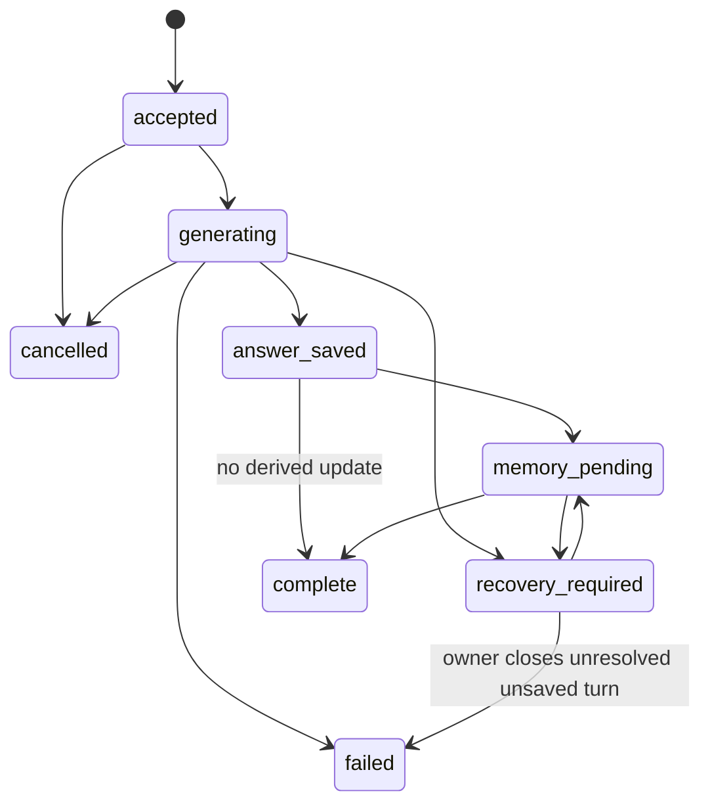

# 契約設計 / Contract design

更新 / Updated: 2026-11-27。health、Session／Message、CreateTurnRequest／ModelClient契約、Bearer認証、session metadataの作成・取得・一覧、許可model ID一覧と環境起動を検証済みです。以下の完全API・turn処理・永続化は設計です。証拠は[PLAN.md](../PLAN.md)。

Verified implementation includes health, Session/Message, CreateTurnRequest/ModelClient contracts, Bearer authentication, session-metadata creation/retrieval/listing, configured model IDs and environment-based startup. The complete API below, turn processing and persistence remain designs. Evidence is in [PLAN.md](../PLAN.md).

現在のPOST bodyは `{"schema_version":"1","policy_id":"full-history-v1"}` の単一JSONで、未知fieldと4096 bytes超を拒否します。201とLocationを返し、responseはid、policy_id、revision、created_atです。取得と一覧も同じmetadataだけで、一覧の順序は未定義、空は配列です。不存在・他所有者は同じ404。errorは最小の `{"code":"..."}` で完全envelopeではありません。memory storeは再起動で失われます。

The current POST body is one JSON value, `{"schema_version":"1","policy_id":"full-history-v1"}`; unknown fields and bodies over 4096 bytes are rejected. Success returns 201 and Location with id, policy_id, revision and created_at. Retrieval/listing return the same metadata only; list order is unspecified and empty lists are arrays. Missing and foreign-owned sessions share a 404. Errors use minimal `{"code":"..."}` responses, not the full envelope. The memory store is lost on restart.

<a id="token-authenticator"></a>

## TokenAuthenticatorの学習契約 / TokenAuthenticator learning contract

`Principal` は一つのidentity（`LabID`, `UserID`）を表します。`principals` は複数形で、server設定の `map[string]Principal`、つまりtoken → identityの対応です。session、chat履歴、model一覧は保存しません。`NewPrincipal` の非空検証だけでは本人確認になりません。

`Principal` represents one identity (`LabID`, `UserID`). The plural `principals` is a server-configured `map[string]Principal`: a token-to-identity mapping. It stores neither sessions nor chat history nor a model list. Nonempty-field checks in `NewPrincipal` alone do not authenticate a caller.

| 名前 / Name | 意味 / Meaning |
| --- | --- |
| constructorの `principals` / constructor parameter | 呼出し側から受け取る設定map / Configuration map supplied by the caller |
| `copied` | 検証したentryを格納する新map / New map holding validated entries |
| `a.principals` | authenticatorが保持する独立した設定map / Authenticator-owned configuration map |
| `principal` | 一つのtokenで検索したidentity / One identity resolved from a token |

constructorは空設定・空token・token内の空白・空identityを拒否し、新mapにentryをコピーします。現在のPrincipalはstring fieldのみなので、このコピーで呼出し側のmap変更から隔離できます。環境から単一local利用者の設定を読込みます。実credential配布・更新は未実装です。合成test tokenはtest専用で、実credentialをcode、log、公開文書に置きません。

The constructor rejects empty configuration, empty tokens, whitespace inside tokens and empty identities, then copies entries into a new map. Principal currently contains only string fields, so this isolates authentication from caller-side map mutation. Environment loading configures one local user; real-credential provisioning and rotation are not implemented. Synthetic test tokens are test-only; real credentials do not belong in code, logs or public documentation.

`Authenticate(r *http.Request)` はちょうど一つのAuthorization値を要求し、`strings.Fields` でschemeとtokenの二つに分けます。schemeは `Bearer` と大小文字を無視して比較し、tokenは完全一致で検索します。成功時はserverのPrincipalとnil、失敗時は空Principalとtokenを含まないerrorを返します。`*http.Request` は標準HTTP handlerから渡される非nilのrequest pointerで、componentはそのheaderを読み取ります。

`Authenticate(r *http.Request)` requires exactly one Authorization value and uses `strings.Fields` to split it into scheme and token. It compares the scheme to `Bearer` case-insensitively, then looks up the token exactly. Success returns the server-configured Principal and nil; failure returns an empty Principal and an error without the token. `*http.Request` is the non-nil request pointer supplied by a standard HTTP handler; the component reads its headers.

流れは「server設定 → constructorでコピー → Authorizationのtoken検索 → Principal → session所有者検証」です。HTTP認可接続は実装済みです。body・query・独自identity headerは認証identityの根拠になりません。RequireAuthが失敗を401へ変換し、認証成功後も `CanAccessSession` による所有者検証が必要です。

The flow is: server configuration → constructor copy → Authorization-token lookup → Principal → session ownership check. HTTP authorization is wired up. Body, query and custom identity headers are not sources of authenticated identity. RequireAuth translates authentication errors into 401 responses; successful authentication still requires ownership authorization with `CanAccessSession`.

## 正本とscope / Authority and scope

| Record / 記録 | 必須の意味 / Required meaning |
| --- | --- |
| Principal | credentialから解決する `lab_id`, `user_id`。bodyから採用しない / Resolve lab_id/user_id from credentials, never from the body |
| Session | `id`, owner scope, `policy_id`, `policy_version`、原文版・失効世代、status、timestamps。policyは作成時固定 / Identity, ownership, fixed policy/version, source revision, invalidation epoch, status and timestamps |
| Message | `id`, `session_id`, author/role, content, source revision, created time。訂正も新しいsource / Identity, session, author/role, content, revision and time; a correction is a new source |
| Turn | request ID、payload hash、user/answer message IDs、要求model、実行modelの証拠（取得時）、状態、usage、pending operation / Request ID/hash, message IDs, requested model, evidence of executed model when available, state, usage and pending operation |
| MemoryRecord | worker memory ID、scope、text、source IDs、記憶版・適用済み原文版・session世代、抽出version、validity / Worker ID, scope, text, source IDs, memory/applied-source revisions, session epoch, extraction version and validity |
| ContextPlan | policy/version、選択source/memory IDs、token budget、omissions、count方式 / Policy/version, selected IDs, budget, omissions and counting method |
| RunManifest | case/config hash、code/dependency/model versions、policy、seed、artifact hash / Case/config hashes, code/dependency/model versions, policy, seed and artifacts |

scopeは `(lab_id, user_id, session_id, experiment_id, policy_id)` を基本とし、実験のない通常sessionは明示的なdefault namespaceを使用します。clientが指定したIDは検索keyであり、アクセス権にはなりません。memory ID直接操作にも所有者確認が必要です。

Scope is based on (lab_id, user_id, session_id, experiment_id, policy_id), with an explicit default namespace for ordinary sessions. Client-supplied IDs are lookup keys, not authorization. Direct memory-ID operations also require ownership checks.

### revisionの意味 / Revision semantics

「revision」を一つの曖昧な値にしません。以下は保存・worker設計用の意味とfield名候補で、現行 `CreateTurnRequest` へfieldを追加する指示ではありません。wire名・初期値・型は対応schemaの受入時に固定します。

Do not use one ambiguous revision value. The following are semantic roles and candidate field names for storage/worker design, not instructions to add fields to the current `CreateTurnRequest`. Freeze wire names, initial values and types when accepting the relevant schema.

| 意味・候補 / Meaning and candidate | 更新・検証主体 / Update and verification owner |
| --- | --- |
| 原文版 / `source_revision` | Goが原文追記・訂正messageのtransaction内で単調増加させる。source IDは旧版でも参照可能 / Go advances it monotonically within source-append/correction transactions; older source IDs remain referencable |
| 失効世代 / `session_epoch` | Goが削除開始時に進めて永続化。worker operationは受付時とcommit前に世代を照合し、古いwriteを拒否 / Go advances and persists it when deletion starts; worker operations check the epoch on admission and before commit, rejecting stale writes |
| 記憶の版と適用範囲 / `memory_revision`, `applied_source_revision` | workerがrecordの更新版と反映済み原文版を区別して永続化。scope・session世代と共に返す。出典のID一覧を代替しない / Worker persists both the memory-record version and applied-source revision, returning them with scope/session epoch; these do not replace source ID lists |

削除はGoの世代更新だけでは完了しません。workerが永続的な失効境界を受理し、進行中operationとの競合を制御して全派生storeを除去した証拠を返した後、Goが `deleted` を確定します。client側で古い応答を捨てるための値は手元だけの値であり、server認可や削除世代の代用にはしません。

Deletion does not complete merely by advancing Go's epoch. The worker must persist the invalidation boundary, coordinate concurrent operations and verify removal from all derived stores before Go confirms `deleted`. A value a client uses to discard stale responses is local only; it never replaces server authorization or deletion epochs.

<a id="source-order"></a>

**原文版と会話順（2026-11-27に利用者が決定） / Source revision and conversation order (decided by the user on 2026-11-27).** `Session.Revision` は原文版です。作成時は1で、user・assistantのmessageを1件追記するたびに1増えます。失敗・取消のturnが残したuser messageも数えます。会話順は、storeが排他区間の中で採番するsession内の単調増加の連番で表します。時刻は表示用で、順序の判定に使いません。messageの連番は、その追記で進んだ後の原文版と同じ値にする案で、実装の形はL4-4で確定します。

`Session.Revision` is the source revision. It is 1 at creation and advances by one for every appended user or assistant message, including user messages left by failed or cancelled turns. Conversation order is a monotonically increasing per-session sequence number assigned by the store inside its critical section. Timestamps are for display and never decide order. The proposal is that a message's sequence number equals the source revision reached by that append; L4-4 settles the implementation shape.

## Native API案 / Proposed native API

| Route | 意味 / Meaning |
| --- | --- |
| `GET /health` | 実装済みliveness。依存の正常性は示さない / Implemented liveness; does not prove dependencies are ready |
| `GET /v1/capabilities` | API/schema/build version、利用可能policy、準備状態 / API/schema/build versions, policies and readiness |
| `GET /v1/models` | 許可済みlocal model ID・能力のみ。自動downloadなし / Allowlisted local model IDs/capabilities; no automatic download |
| `POST /v1/sessions` | policyを固定してsession作成 / Create a session with fixed policy |
| `GET /v1/sessions` | 所有sessionの一覧 / List owned sessions |
| `GET /v1/sessions/{id}` | 受入済みの4項目のmetadata / Accepted four-field metadata response |
| `GET /v1/sessions/{id}?view=conversation` | 提案。所有sessionのmessageとturnを再読込 / Proposed opt-in view of messages and turns in an owned session |
| `POST /v1/sessions/{id}/messages` | 1つのuser message、model ID、request IDを受理 / Accept one user message, model ID and request ID |
| `GET /v1/sessions/{id}/turns/{request_id}` | 下記の正確なturn状態enumを照会 / Read the exact turn-state enum defined below |
| `POST /v1/sessions/{id}/turns/{request_id}/cancel` | 取消を要求し、確定状態を返す / Request cancellation and return authoritative state |
| `POST /v1/sessions/{id}/turns/{request_id}/reconcile` | 不確定operationを確認して回復。再生成は暗黙実行しない / Inspect/recover uncertain operations; no implicit regeneration |
| `GET /v1/sessions/{id}/memories` | 出典・revision付き記憶の閲覧 / Inspect memories with provenance and revisions |
| `GET /v1/sessions/{id}/export` | versioned JSON export、scopeと機密情報を制限 / Versioned JSON export with scope and sensitive-data controls |
| `DELETE /v1/sessions/{id}` | 削除開始。完了まで状態照会し、全storeの除去を確認 / Start deletion; poll and verify removal from all stores |
| `GET /v1/runs` / `GET /v1/runs/{id}` | 所有する完了／失敗runのmetricsを閲覧 / Read owned completed/failed-run metrics |

最初のmessage APIは非streamingのjob型です。新規受理時は202、送信時の `request_id`、および `GET /v1/sessions/{id}/turns/{request_id}` を指すLocationを返す案です。回答保存前の切断でも同じIDで再照会できます。削除は202で開始し、sessionの `deleting/deleted` 状態を確認します。deleted tombstoneは本文を持たず、所有者だけが一定期間照会可能とする提案です。

The initial message API is a non-streaming job API. For a newly accepted request, the proposal returns 202, the submitted `request_id` and a Location pointing to `GET /v1/sessions/{id}/turns/{request_id}`. A disconnected client can use that same ID to retrieve the outcome. Deletion begins with 202 and exposes deleting/deleted session state. A content-free deleted tombstone is proposed for owner-only status queries during a defined retention period.

<a id="session-recovery-export"></a>

### 再読込とexportの応答案 / Proposed reload and export responses

**再読込（S1から） / Reload (from S1).** CLIの `session show --conversation` や後の研究UIのChatが `view=conversation` を指定した時に、metadata、会話順のturn（要求ID・要求model・状態・message参照）、対応するmessageを同じsnapshotで返す案です。進行中や回復待ちのturnも返します。clientが送信応答と手元のIDを失っても、受理済みのturnをこの一覧から照会できます。受理の記録を確認できない間は自動送信せず、状態を再読込します。別所有者には従来通り不存在と同じ404を返します。既定の4項目は[既存のGETテスト](../cmd/bridge/session_get_http_test.go)で検証します。

When the CLI's `session show --conversation` or the later research UI's Chat requests `view=conversation`, return metadata, turns in conversation order (request ID, requested model, state and message references) and their messages in one snapshot. Include active turns and those awaiting recovery. A client that lost both the submission response and the request ID can find admitted work in this list and query it. While admission is uncertain, refresh status without automatically submitting. Foreign sessions retain the same 404 as missing sessions. The [existing GET test](../cmd/bridge/session_get_http_test.go) checks the four-field default.

**Exportと削除（S3） / Export and deletion (S3).** 完全exportは一つの所有sessionの正本snapshotと、同じ世代でその時点までに必要な記憶更新を反映した出典を含みます。全履歴では派生記憶は不要です。例として、12日から15日への訂正が記憶更新待ちなら409を返し、回復後に再取得します。workerが利用不能なら503です。Goは応答確定直前に所有scope・世代と対象版を再照合し、途中で削除が始まった場合は本文を返しません。削除完了は管理対象storeに適用され、既に利用者が保存したexportは手元に残ります。

A complete export includes one owned session’s source snapshot and provenance from any required memory updates through that snapshot in the same session epoch. Full history needs no derived memory. For example, if the correction from the 12th to the 15th awaits a memory update, return 409 so the owner can export after recovery. Worker unavailability returns 503 when that worker is required. Before committing the response, Go rechecks the owner scope, epoch and target revisions. If deletion won the race, return no session content. Confirmed deletion covers the managed stores. A copy already downloaded by the user stays with them.

契約fixture例（所有者・履歴はserverが決定） / Example contract fixture (the server determines ownership and history):

```json
{
  "schema_version": "1",
  "request_id": "synthetic-turn-003",
  "model_id": "local-model-b",
  "content": "Correction: the deadline is November 15."
}
```

clientからの `user_id`, `lab_id`, `system`, 過去assistant messageを正本として受理しません。設定した長さ上限を超えた入力、未知model、不正role、未知の重要fieldは明示拒否します。public API schemaとworker schemaは別versionで管理します。

Do not accept client-supplied user_id/lab_id, system instructions or past assistant messages as authoritative records. Explicitly reject excessive input, unknown models, invalid roles and unknown critical fields. Public and worker schemas have separate versions.

<a id="turn-states"></a>

## 重複、状態、失敗 / Duplicates, states and failures

同じsessionとrequest IDで同じpayloadを再送した場合、既存turnを返します。内容が違えば409 conflictです。別request IDでも処理中turnがあれば409 busyを返し、暗黙queueは作りません。重複判定にmodel IDと生成設定も含めます。

Resending the same payload under the same session/request ID returns the existing turn. A changed payload returns 409 conflict. A different request while a turn is active returns 409 busy, without an implicit queue. Deduplication includes model ID and generation settings.

turn状態の正本名は `accepted`, `generating`, `answer_saved`, `memory_pending`, `complete`, `failed`, `cancelled`, `recovery_required` です。`running` や `pending` という別名へ変換しません。sessionの `deleting/deleted` は別の状態型です。以下の図は主な生成・保存回復経路を示し、取消競合等は契約fixtureで固定します。

Canonical turn states are `accepted`, `generating`, `answer_saved`, `memory_pending`, `complete`, `failed`, `cancelled` and `recovery_required`. Do not introduce aliases such as running or pending. Session deleting/deleted uses a separate state type. The diagram shows principal generation/persistence-recovery paths; freeze cancellation races and other details with contract fixtures.



`memory_pending`からの回復は保存answerを再生成しません。推論中crashの `recovery_required` は実行結果の有無を調べ、必要なら明示的な新requestでやり直します。上図の回復→memory_pendingはanswer保存済みの場合だけです。全履歴policyは派生更新なしでcompleteへ進めます。取消はbest effortで、保存済みanswerを取り消しません。

Recovery from memory_pending never regenerates a saved answer. For a crash during inference, recovery_required inspects whether a result exists; a new explicit request may be needed. The diagram's recovery→memory_pending transition applies only to saved answers. Full-history policy can complete without a derived update. Cancellation is best effort and does not undo a persisted answer.

<a id="restart-cut-points"></a>

**再起動時の判定案（S2） / Proposed restart decisions (S2).** 外部呼出しの前に `generating` を確定し、回答・usage・`answer_saved` は一つのtransactionで保存します。これで再起動時に次の区別ができます。

Commit the move to `generating` before dispatching to the model. Commit the answer, usage and `answer_saved` in one transaction. Those boundaries give the recovering executor the following decisions.

| 再起動時の正本 / Durable record on restart | 回復する動作 / Recovery action |
| --- | --- |
| `accepted` | 未送出の同じturnを一度だけ排他的に取得し、通常の期限・取消条件で続行 / Claim the undispatched turn once and continue under the normal deadline and cancellation rules |
| `generating`、保存回答なし / No committed answer | `recovery_required` にして次送信を保留。照合しても結果を確定できない場合、所有者は既存reconcile操作で「回答なしで終了」を選べる。正本の回答が依然なく同じturnが回復待ちの場合だけ原子的に `failed` とし、実行結果不明の理由を残す。旧turnは再開せず、遅い結果を書き込ませない。その後の再試行は新IDで明示送信 / Hold new sends in `recovery_required`. If reconciliation cannot resolve the outcome, the owner may explicitly close the turn without an answer via reconcile. Atomically require that the same turn still awaits recovery and has no committed answer. Mark it `failed`, retain the unknown execution outcome and reject late writes to that turn. Any subsequent retry is an explicit new request ID |
| 全履歴の `answer_saved` または `complete` / Full-history saved or complete | 保存回答を同じIDで返し、必要なら `answer_saved → complete` を確定。追加の推論は0回。派生記憶のある方式では未完了の記憶更新だけを照合（S3） / Return the committed answer under the same ID and finish `answer_saved → complete` if needed. Zero additional generations. For a policy with derived memory, reconcile outstanding memory work separately in S3 |

error envelopeは `code`, `request_id`, `retryable`, `state` を持ち、CLIはcodeをそのまま表示して[終了code](cli.md)に対応付け、後の研究UIはcodeを日英へ翻訳します。stack traceやprompt本文は返しません。401は認証失敗、他人のobjectは存在を漏らさない404、409は競合、422は不正要求、429は呼出し側ごとの上限超過（L4-11の提案）、503は依存未準備を出発案とします。受理後の失敗はGETのturn状態で表します。現行の実装はこのほかに、4096 bytes超のbodyへ413、routeにないmethodへ405、内部の生成・encode失敗へ500を返します。

The error envelope carries code, request_id, retryable and state; the CLI prints the code unchanged and maps it to an [exit code](cli.md), and the later research UI translates codes into JA/EN. Do not return stack traces or prompt text. Initial mappings: 401 authentication failure, 404 for others' objects without disclosing existence, 409 conflict, 422 invalid request, 429 per-caller limit exceeded (proposed for L4-11), 503 dependency unavailable. Failures after acceptance are represented in the retrieved turn state. The current implementation also returns 413 for bodies over 4096 bytes, 405 for methods a route does not define and 500 for internal generation or encoding failures.

<a id="l4-turn-design"></a>

## L4の全履歴turn設計 / L4 full-history turn design

2026-11-18の提案です。確認基点は `4f341b0` の [Go契約](../cmd/bridge/contracts.go)、[session store](../cmd/bridge/session_store.go)、[HTTP接続](../cmd/bridge/main.go) です。L4では同じGo process内の `full-history-v1` sessionと合成 `ModelClient` で、生成前後の状態・履歴を検証します。

This proposal, dated 2026-11-18, draws on the [Go contracts](../cmd/bridge/contracts.go), [session store](../cmd/bridge/session_store.go) and [HTTP wiring](../cmd/bridge/main.go) at `4f341b0`. L4 uses a process-local `full-history-v1` session and a synthetic `ModelClient` to verify state and history around generation.

### 受理と履歴 / Admission and history

1. 認証と所有者確認の後、検証済みの要求をsession IDとrequest IDで検索します。同じ有効payload（schema、model、本文、有効な生成設定）は既存turnを返し、変更は409 conflictです。新規要求はmodelの許可を確認し、空いているsessionでのみ、request記録・user message・`accepted` を一つの原子操作で登録します。別IDで処理中なら409 busyを返します。
2. executorは一度だけturnを `generating` にし、同じsessionの完了済みuser/assistant対を会話順に並べ、今回のuser messageを末尾に一度加えます。訂正前後の原文を両方残します。失敗・取消のuser messageは記録に残し、後続のモデル入力には含めません。
3. executorは保存の排他区間を出て `ModelClient.Generate` を呼びます。有効な結果を受け取ったら、同じturnが `generating` の場合に限り、回答とmodel ID・usageの記録を `answer_saved` への遷移とともに保存します。全履歴では続けて `complete` に進みます。

1. Authenticate and check session ownership before looking up the validated request by session ID and request ID. Matching effective payloads (schema, model, text and effective generation settings) return the existing turn. A change returns 409 conflict. For a new request, check the model allowlist and atomically record the request, user message and `accepted` state when the session is free. A different request ID while a turn is active returns 409 busy.
2. The executor moves the turn to `generating` once. It assembles that session's completed user/assistant pairs in conversation order, followed by the current user message once. Both original and corrected statements remain in history. User messages from failed or cancelled turns remain recorded and are omitted from subsequent model input.
3. Call `ModelClient.Generate` outside the store's critical section. Commit a valid answer, the model ID and usage together with the move to `answer_saved`, only while that turn is still `generating`. With full history, then advance to `complete`.

<a id="replay-equality"></a>

**再送の判定（2026-11-20に利用者が決定） / Replay equality (decided by the user on 2026-11-20).** 同じsessionで同じrequest IDの要求は、schema version・model ID・本文が完全一致する時だけ同一とみなし、既存turnを返します。本文の空白・改行・大小文字の違いも変更です。正規化やhashは使いません。hashは保存を始めるS2で再検討します。現行の `CreateTurnRequest` には生成設定がないため、比較対象はこの3項目です。生成設定を加えるときは比較にも加えます。比較の前に受け取った要求を検証し、不正な要求は競合ではなく不正要求として扱います。request IDが異なる要求は再送ではありません。turnの状態に関係なく同じ判定を使い、失敗・取消のturnへの同一再送は元の終端状態を返します。

Two requests with the same request ID in one session are the same only when schema version, model ID and text match exactly; the existing turn is returned. Any difference in whitespace, line breaks or case in the text is a change. No normalization or hash is used; reconsider hashing when storage starts in S2. The current `CreateTurnRequest` has no generation settings, so these three fields are compared; add settings to the comparison when they are added to the request. Validate the incoming request before comparing, and treat an invalid request as invalid rather than as a conflict. A request with a different request ID is not a replay. The same rule applies whatever the turn's state, so an identical replay of a failed or cancelled turn returns its original terminal state.

**状態の更新（2026-11-20に利用者が決定） / State updates (decided by the user on 2026-11-20).** `Turn` は値として扱います。状態を変えるmethodは元の値を変えず、新しい `Turn` を返します。storeが保持する値を変えるのは、storeの排他区間で新しい値を受け取った時だけです。

Treat `Turn` as a value. Methods that change state return a new `Turn` and leave the original unchanged. The store's held value changes only when it accepts a new value inside its critical section.

### 失敗と競合の確認例 / Failure and race fixtures

同じsession内の会話順は正本への追記順で決めます。時刻が同じでも順序を保持し、modelを履歴の絞り込み条件に使いません。失敗・取消の再送では、元のIDと同じpayloadなら元の終端状態を返します。訂正を有効にするには利用者が新IDで改めて送り、そのturnが完了する必要があります。遅延した旧turnの完了処理は新turnの実行枠を解放できません。枠の解放も対象turnのIDと状態を照合して行います。

Use authoritative append order within the session, including when timestamps tie. Include completed pairs across model IDs. Replaying the original ID and payload after failure or cancellation returns that terminal turn. To apply the correction, the user explicitly submits it under a fresh ID and that turn must complete. A late callback from the old turn cannot release the new turn’s slot. Releasing the slot checks both the turn identity and its state.

| 合成操作 / Synthetic action | 期待する観測 / Expected observation |
| --- | --- |
| 同一sessionでA → B → A / A → B → A in one session | Aが12日を受け、Bで15日に訂正、最後のAへの入力には元の指示・訂正・今回の質問が順に一度ずつ含まれる。固定fakeは15日を返す / A receives the 12th, B receives the correction to the 15th, and the final call to A contains the original instruction, correction and current question once each in order. The deterministic fake returns the 15th |
| 同一requestの同時再送、新規requestとの競合 / Concurrent replay and a competing new request | 同一payloadは同じturnを返し、生成呼出しとuser messageは各1件。変更payloadはconflict、処理中の別IDはbusy / Matching payload returns the same turn with one generation call and one user message. Changed payload conflicts, and a different ID while active receives busy |
| 生成期限、明示取消、遅延結果 / Generation deadline, explicit cancellation and late results | 期限は `failed`、回答保存前の有効な取消は `cancelled`。状態確定後の応答は書き込めず、保存が先に確定した回答は残る / A deadline produces `failed`. An explicit cancellation that wins before answer save produces `cancelled`. Late results cannot write after a terminal decision, and an answer committed first remains available |
| HTTP切断または別所有者による照会 / HTTP disconnect or lookup by a different owner | 受理済みturnは切断後も続行し、所有者はrequest IDで照会できる。他user/labの照会は不存在と同じ404 / Accepted work continues after disconnect and is queryable by the owner via request ID. A lookup from another user/lab receives the same 404 as an absent record |

期限・取消・回答保存の競合は、状態更新を直列化して決着させます。回答保存を確定する時点で生成期限も確認し、期限を過ぎた未確定回答は破棄します。HTTP切断のfixtureと、取消を無視して遅れて応答するfakeのfixtureは別にします。再起動、派生記憶、実モデルの応答品質は後続段階で扱います。作業と受入の一覧は [PLAN.md](../PLAN.md) にあります。

Serialize state changes to settle races between the deadline, cancellation and answer save. Check the generation deadline at commit time and discard an uncommitted answer past that deadline. Use separate fixtures for HTTP disconnect and for a fake that returns late after cancellation. Restart behavior, derived memory and real-model answer quality belong to later stages. See [PLAN.md](../PLAN.md) for work and acceptance tracking.

<a id="other-programs"></a>

## 他のprogramからの利用 / Use from other programs

2026-11-27に利用者が報告した要件です。他の人が書いたprogramも同じAPIを呼べるようにします。以下のうち、認証の方式・到達範囲・schemaの形式は提案で、[未決事項](architecture.md#open-questions)にあります。

This requirement was reported by the user on 2026-11-27: programs written by other people must be able to call the same API. Of what follows, the authentication scheme, network reach and schema format are proposals listed among the [open questions](architecture.md#open-questions).

APIはHTTPとUTF-8のJSONだけを使うので、HTTP clientを持つ言語ならどれからでも呼べます。言語ごとのSDKは要りません。CLIもrunnerも後の研究UIも、この同じAPIを呼ぶclientの一つです。呼出しは次の4段階です。

The API uses only HTTP and UTF-8 JSON, so any language with an HTTP client can call it. No per-language SDK is needed. The CLI, the runner and the later research UI are simply clients of this same API. A call has four steps.

| 段階 / Step | 要求 / Request | 状態 / Status |
| --- | --- | --- |
| 1. 認証 / Authenticate | 全ての `/v1/` 要求に `Authorization: Bearer <token>` / On every `/v1/` request | 受入済み / Accepted |
| 2. session作成 / Create a session | `POST /v1/sessions`、本文 `{"schema_version":"1","policy_id":"full-history-v1"}`。201と `id` が返る / Returns 201 with `id` | 受入済み / Accepted |
| 3. 発言を送る / Send a message | `POST /v1/sessions/{id}/messages`、本文は上の[契約fixture](#session-recovery-export)の4項目。`request_id` は呼出し側が作る。202とLocationが返る / Body has the four fields of the [contract fixture](#session-recovery-export) above. The caller creates `request_id`. Returns 202 with Location | 提案、L4-8 / Proposed, L4-8 |
| 4. 結果を取る / Fetch the result | `GET /v1/sessions/{id}/turns/{request_id}` を終端状態まで繰り返す / Repeat until a terminal state | 提案、L4-8 / Proposed, L4-8 |

```sh
curl -s -X POST http://127.0.0.1:8080/v1/sessions \
  -H "Authorization: Bearer $BRIDGE_TOKEN" -H "Content-Type: application/json" \
  -d '{"schema_version":"1","policy_id":"full-history-v1"}'
```

呼出し側が守る約束は四つです。`request_id` を自分で作って保存し、応答が届かなければ同じIDと同じ本文で再送する。409 busyでは自動で連投しない。状態は[正本の8つの名前](#turn-states)で判定し、未知の状態では送信を止める。`user_id` や `lab_id` を送っても無視され、所有者はtokenで決まる。

A caller keeps four promises. Create and keep its own `request_id`, and replay with the same ID and text when a response is lost. Do not resubmit automatically on 409 busy. Judge state by the [eight canonical names](#turn-states) and stop sending on an unknown one. Any `user_id` or `lab_id` it sends is ignored; the token determines ownership.

言語への対応は、SDKを配るのではなく契約を配る方針です。本書と契約fixtureに加えて、routeと型を記述したOpenAPI fileを一つ置き、呼出し側は自分の言語の生成toolでclientを作れます。fileは契約fixtureと照合するtestで実装とのずれを検出します。project自身が保守するclientはGoの `internal/client` だけです。

Language support means distributing the contract, not SDKs. Alongside this document and the contract fixtures, one OpenAPI file describes routes and types, and callers can generate a client with their own language's tooling. A test compares the file with the contract fixtures to catch drift from the implementation. The only client this project maintains is Go's `internal/client`.

現在の実装で足りないものは二つです。tokenは一つで全員が同じ所有者になり、loopback以外では待ち受けません。同じ機械の上のprogramは今でも呼べますが、他の人ごとの隔離と他の機械からの到達には、未決事項の決定が要ります。

The current implementation lacks two things. There is one token, so every caller would be the same owner, and the server refuses to listen beyond loopback. A program on the same machine can call it today, while per-person isolation and reach from other machines await the open decisions.

OpenAI互換のrouteは提供しません。既存のOpenAI用clientの要求にはsession IDがなく、base URLを変えるだけでは同じsessionの継続になりません。必要が出たら別ADRで扱います。

No OpenAI-compatible route is offered. Requests from existing OpenAI clients carry no session ID, so changing the base URL alone does not continue a session. Handle it in a separate ADR if the need arises.

## Worker契約 / Worker contract

Goはversioned local HTTP/JSONで `ingest`, `search`, `inspect`, `export`, `delete`, `operation-status` を呼ぶ提案です。全操作にservice認証、scope、session世代、operation IDを含め、ingestには対象source IDsと原文版も付けます。Goとworkerはそれぞれscopeを検証します。workerはraw Mem0 objectを公開せず、project DTOに正規化します。

Go uses proposed versioned local HTTP/JSON operations: ingest, search, inspect, export, delete and operation-status. Every operation carries service authentication, scope, session epoch and operation ID; ingest also carries target source IDs and source revision. Go and the worker both validate scope. The worker normalizes Mem0 objects into project DTOs.

同じscope・operation ID・payloadの再送は記録済み状態を返し、異なるpayloadは競合として拒否します。更新完了が不明なときはsource mappingとstoreを照合します。Mem0が自動でtransaction、完全出典、exactly-once処理を保証すると仮定しません。削除世代より古いwriteは拒否します。

Replaying the same scope, operation ID and payload returns recorded state; a different payload is a conflict. Uncertain completion requires source-mapping/store reconciliation. Do not assume Mem0 provides transactions, complete provenance or exactly-once processing. Reject writes older than the deletion epoch.

## versionと検証 / Versions and verification

API schema、DB migration、worker protocol、policy、metricsには独立versionを付けます。追加fieldには互換性規則、削除や意味変更には新versionを定義します。client側の型定義だけでは実HTTP応答を検証できないため、境界の実行時検証とcontract fixtureも必要です。L2で受入済みの契約はGoのDTOとinterfaceです。OpenAPIなどの機械可読schemaは、今後のHTTP API実装に合わせて本人が維持する提案であり、作成済みの成果物ではありません。

Version API schemas, DB migrations, worker protocol, policies and metrics independently. Define compatibility for additive fields and new versions for removals/semantic changes. Client-side type definitions do not validate real HTTP responses, so runtime boundary validation and contract fixtures are also required. L2 accepted the Go DTO and interface contracts. A machine-readable schema such as OpenAPI is proposed for the user to maintain alongside future HTTP API implementation; it is not an existing deliverable.

互換追加は、旧consumerが無視できる任意response fieldに限定します。未知の重要request fieldは拒否し、新必須field、enum値、stateの意味の変更を自動的に互換としません。CLIやUIが未知stateを受け取った場合は非互換を明示し、送信を止めます。HTTP・worker・CLI・UIのfixtureで同じ用語を確認します。

Compatible additions are optional response fields that older consumers can ignore. Reject unknown critical request fields, and do not assume new required fields, enum values or state meanings are compatible. A CLI or UI receiving an unknown state reports incompatibility and blocks sending. HTTP, worker, CLI and UI fixtures verify shared terminology.
