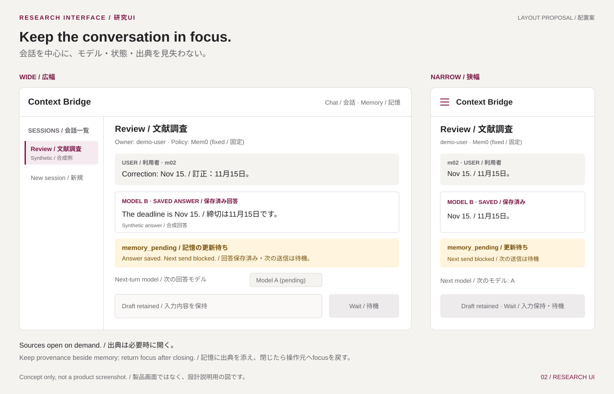

# 研究UI設計 / Research UI design

更新 / Updated: 2026-11-12。小型の自作React UIを先行し、第三者UIは後続の任意拡張とします。以下は提案で、UIコード・package manifest・依存はまだ作成／導入していません。 / Build a small owned React UI first; third-party clients are optional later. This is a proposal; UI code, package manifests and dependencies have not been created/installed.

## 選択：React + TypeScript + Vite + Mantine / Selection

Reactで画面を分割し、TypeScriptでAPI契約を表現し、Viteで開発・静的buildを行います。Mantineの部品とlibrary stylesを利用し、初期版では独自CSS、Tailwind、CSS Modulesを追加しません。default theme、layout props、component propsで実現できる範囲に画面を絞ります。

Use React for views, TypeScript for API contracts and Vite for development/static builds. Use Mantine components and library styles; add no handwritten CSS, Tailwind or CSS Modules initially. Keep the design within default themes, layout props and component props.

これは保守負担を抑える設計判断です。React公式資料はViteによる構築を説明していますが、routing・data取得を自分で管理する負担も示しています。小型local UIではその範囲を限定します。[React](https://react.dev/learn/build-a-react-app-from-scratch)、[Mantine/Vite](https://mantine.dev/guides/vite/)、[スタイル / Styles](https://mantine.dev/styles/styles-overview/)（2026-11-08参照）。

This is a maintenance decision. React's documentation describes Vite-based setup and also notes the responsibility for routing/data fetching. Limit that responsibility for this small local UI. Sources: [React](https://react.dev/learn/build-a-react-app-from-scratch), [Mantine/Vite](https://mantine.dev/guides/vite/), [styles](https://mantine.dev/styles/styles-overview/) (accessed 2026-11-08).

| 候補 / Candidate | 適合性 / Fit | 判断 / Decision |
| --- | --- | --- |
| Mantine | AppShell、layout、入力、dialog、feedbackを組み合わせやすい / Composable shell, layout, inputs, dialogs and feedback | 2026-11-08に選択。必要部品だけ使う / Selected 2026-11-08; use only required parts |
| Ant Design | Form/Table中心の管理画面向け / Fits form/table-heavy administration | 実験管理台が主用途になれば再検討 / Revisit if experiment administration dominates |
| Material UI | 一貫したMaterial Designの部品群 / Consistent Material Design components | 好みが合えば代替。追加製品のlicenseを個別確認 / Alternative if preferred; audit additional products separately |

Mantineだけを導入対象とし、他候補は同時導入しません。Mantine core LICENSEはMITを確認しましたが、実際に使うpackage、icons、test dependenciesと推移依存は未監査です。部品はdefault themeのままでも利用できますが、libraryを使うだけでaccessibilityが保証されるわけではありません。[資料台帳](sources.md)を参照してください。

Only Mantine is in installation scope; do not install the alternatives alongside it. Mantine core is verified as MIT; actual packages, icons, test dependencies and transitive dependencies remain unaudited. Components can use the default theme, but a library alone does not guarantee accessibility. See the [source register](sources.md).

## 3つの画面 / Three views

| 画面 / View | 操作と表示 / Interaction and display | Mantine候補 / Candidate components |
| --- | --- | --- |
| Chat / 会話 | appが選択したsessionの会話、modelはturnごとに選択、送信、取消、状態、再読込 / Conversation for the app-selected session, model per turn, send/cancel/status/reload | AppShell, NavLink, Select, ScrollArea, Paper, Textarea, Button, Badge, Alert |
| Memory / 記憶 | 記憶text、source message、revision、訂正の参照、取得済み記録の絞込 / Memory text, source messages, revisions, correction references and filtering loaded records | Table, Accordion, TextInput, Drawer |
| Results / 結果 | 既存runのpolicy、model、品質、token、時間、失敗・欠測 / Existing runs: policy, model, quality, tokens, time, failures/missing data | Table, Select, Badge, Alert |

最初のUIはChatとMemoryを実装し、Resultsはrunnerのmetrics schemaが固定してから追加します。実験開始buttonは初期版に含めません。UI操作で大量推論や遠隔jobを暗黙起動させないためです。図表は必要になってからOSSのchart libraryを個別監査します。

Implement Chat and Memory first; add Results after the runner's metrics schema is fixed. The initial UI has no experiment-launch button, preventing accidental bulk inference or remote jobs. Audit an OSS chart library separately only when plots are needed.

sessionの作成・選択・export/deleteはappの共通session操作として扱います。Memory内から操作を示す場合もappへ要求し、session全体への影響を説明します。「絞込」は取得済みの記録を対象とし、workerの意味検索や未定義の検索APIとは区別します。

Session creation, selection and export/delete belong to shared session operations in app. If Memory exposes an entry point, it delegates the request to app and explains the session-wide scope. Filtering applies to loaded records; it is distinct from worker semantic retrieval or an undefined search API.

## 情報の優先順位と配置 / Information hierarchy and layout



図は説明用の配置案で、動作画面や実測結果ではありません。図中の情報は以下にも記載し、画像が表示されなくても仕様を読めるようにします。素材と公開サイトの視覚方針は[デザイン資料](design.md)に集約します。

The figure is a layout proposal, not a working screen or measured result. Its information is also specified below so the design remains readable without the image. See the [design reference](design.md) for assets and public-site visual direction.

| 優先度・領域 / Priority and area | 表示・操作の原則 / Display and interaction |
| --- | --- |
| 1. Sessionの識別 / Session identity | 上部にsession名・ID、認証済みowner、作成時に固定したpolicyを表示。切替後も現在のsessionを明示 / Show session name/ID, authenticated owner and the policy fixed at creation at the top; keep the current session identifiable after switching models |
| 2. 会話と状態 / Conversation and state | 原messageを時系列で表示。各回答には実行時modelとturn状態を併記し、次のmodel選択で過去のlabelを書き換えない / Show source messages chronologically; label each answer with its generating model and turn state, never relabel past answers when choosing the next model |
| 3. 次の入力 / Next input | model選択を入力欄の近くに置き、「次の回答モデル / Model for next turn」と表示。送信可否の理由を入力欄の直前に示す / Place the model selector beside the composer with “Model for next turn”; explain why sending is unavailable immediately above the composer |
| 4. 根拠の確認 / Inspect evidence | Memoryを「派生記憶 / Derived memory」と表示。記憶text、現在のrevision、source IDs・原messageへの移動を一組で見せる / Label Memory as “Derived memory”; group its text, current revision, source IDs and navigation to source messages |

Memoryでは有効な記録と置き換え済みの記録を分け、色だけで区別しません。訂正は新しいuser messageとして正本へ追加する設計です。UIだけで記憶を上書きしたり、assistant回答を検証済み事実として表示したりしません。source閲覧も現在のowner scope内に限定します。

Separate current and superseded memory records with explicit labels, not color alone. Corrections enter the source history as new user messages. Do not overwrite memories only in the UI or label assistant answers as verified facts. Source inspection remains within the current owner's scope.

広幅では左にsession navigation、中央に会話と入力を置き、出典は必要時だけDrawerで開く案です。狭幅ではnavigationを閉じ、会話と入力を一列にします。常設の3列表示や縮小した情報カードで読字幅を圧迫しません。Drawerを閉じたら開いた操作へfocusを戻し、隠れた領域をTabで辿らせません。

For wide layouts, place session navigation on the left and conversation/composer in the center, with source details in a Drawer opened on demand. On narrow screens, collapse navigation and use one conversation/composer column. Avoid permanent three-column layouts or shrunken information cards that constrain reading. Closing a Drawer restores focus to its trigger, and hidden regions must not remain in the Tab sequence.

これらはMantineのAppShell、Stack、Group、Drawer等のlibrary部品と公開propsで表現する提案です。自作CSSや新しいlayout libraryは追加しません。重要情報と操作はtextで提供し、説明用SVGを実際の入力・状態表示の代用にしません。具体的なbreakpointと部品APIは採用versionの監査・実装時に確認します。

These are proposals to use Mantine components such as AppShell, Stack, Group and Drawer through their public props. Add no handwritten CSS or extra layout library. Provide essential information and actions as text; explanatory SVGs do not replace actual inputs or state displays. Verify specific breakpoints and component APIs when auditing and implementing the selected version.

## 画面とモジュール / View and module structure

```text
web/src/
  app/                 組立・認証・session・日英navigation / composition, auth, session, JA/EN navigation
  features/chat/       会話・入力・turn表示 / transcript, composer, turn presentation
  features/memory/     派生記憶・出典・絞込 / derived memories, sources, filtering
  features/results/    結果閲覧 / read-only runs and metrics
  lib/api/             HTTP通信・契約読込・エラー変換 / HTTP client, contract decoding, errors
  lib/contracts/       版付きDTO・状態・境界検証 / versioned DTOs, states, boundary validation
  locales/             日英文字列 / ja/en strings
  theme/               Mantine設定 / Mantine provider configuration
  test/                assistant担当のfixtureとtest設定 / assistant-owned fixtures/setup
```

上記は予定の配置で、空directoryを先に作る要求ではありません。主な依存方向は `app → features → lib/api → lib/contracts` です。上位層は必要な下位層を直接参照できますが、逆方向には依存しません。認証・session共通操作を行うappもAPI clientを利用します。features同士は内部fileをimportせず、appがprops・callbackで組み合わせます。

This is a target layout, not a request to create empty directories in advance. The main dependency direction is `app → features → lib/api → lib/contracts`. Higher layers may access required lower layers directly, but dependencies never point upward. App also uses the API client for shared authentication/session operations. Features do not import one another's internal files; app composes them through props and callbacks.

| 境界 / Boundary | 所有する責務 / Owns | 含めない責務 / Excludes |
| --- | --- | --- |
| `app` | 認証lifecycle、現在のsession、revision、要求世代、画面間移動、削除後の一括除去 / Authentication lifecycle, active session, revision, request epoch, navigation and deletion-wide cleanup | 記憶抽出、backendの所有権判定、全featureの表示detail / Memory extraction, backend authorization and every feature's presentation details |
| `features/*` | view、必要なcontroller/hook、入力draft、server snapshotの表示状態 / Views, controllers/hooks as needed, drafts and server-snapshot presentation | 直接fetch、他featureの内部state、独自のturn完了判定 / Direct fetch, another feature's internal state or inferred turn completion |
| `lib/api` | HTTP、認証情報の付与、取消可能なrequest、DTO読込、error envelope / HTTP, supplied authentication, abortable requests, DTO decoding and error envelopes | React/Mantine、翻訳文言、無条件POST再試行 / React/Mantine, translated copy and blind POST retries |
| `lib/contracts` | `/v1`の伝送DTO、明示state、versionと応答shapeの検証 / Transport DTOs for /v1, explicit states, version/response-shape validation | React、HTTP実行、vendor SDK型、画面layout / React, HTTP execution, vendor SDK types and screen layout |

HTTP応答は境界で検証してからfeatureへ渡します。型assertionだけで正常とみなさず、非互換schemaや未知のturn状態では操作を止めて説明します。error codeの翻訳はlocalesを使う表示側が担当し、API clientはcodeを保持します。Ollama・Mem0・Qdrantへbrowserから直接接続しません。

Validate HTTP responses at the boundary before passing them to a feature. A type assertion is insufficient; an incompatible schema or unknown turn state disables dependent actions with an explanation. The presentation layer translates error codes through locales while the API client preserves the codes. The browser never connects directly to Ollama, Mem0 or Qdrant.

認証・選択sessionの変更時と削除開始時にappが要求世代を進め、featureは開始時の世代とsessionを記録します。応答の適用前にそれらとserver revisionを検証し、古い要求や削除済みsessionの応答を破棄します。Memoryから原messageを開く場合はIDをcallbackでappへ渡し、appがChatへ移動します。削除確定時はappが会話・記憶・選択中の出典・draftをまとめて除去します。

App advances the request epoch when authentication or the selected session changes and when deletion starts; features capture the epoch and session when starting requests. Before applying responses, validate that context and the server revision, discarding obsolete requests and responses for deleted sessions. Memory opens a source message by passing IDs through a callback to app, which navigates to Chat. Confirmed deletion makes app clear the conversation, memory, selected source and draft together.

browserの要求世代、serverの削除世代、原文版、記憶版は同じ値ではありません。[revisionの契約](contracts.md)に従い、応答のscope・世代と対象snapshotを照合します。古いsource messageも訂正の履歴として有効な参照になり得るため、古い版であることだけで出典を無効にしません。

The browser request epoch, server deletion epoch, source revision and memory revision are different values. Follow the [revision contract](contracts.md) when matching response scope/epoch and the requested snapshot. An older source message can remain a valid correction-history reference; age alone does not invalidate provenance.

状態はまずReactのlocal state／reducerで管理し、複雑なrouting、Redux、global query cacheは初期追加しません。Mantineの部品はviewで直接使い、共通部品は`TurnStatus`や`SourceReference`など意味が重複する箇所だけにします。Button/Table一式のwrapperや何でも入る`shared/utils`を作らず、独立した責務・再利用・testの必要が現れたときに分離します。

Start with React local state/reducers; do not initially add complex routing, Redux or a global query cache. Views use Mantine directly, extracting shared components only for repeated domain concepts such as TurnStatus or SourceReference. Avoid a full Button/Table wrapper layer or a catch-all shared/utils directory; extract modules when responsibility, reuse or testing justifies them.

検証の接点は境界に置きます。DTOの合成fixtureでversion・欠落field・未知stateを、差し替え可能なHTTP transportでrequest ID・error変換・自動再送の不在を、featureのtestで二重送信・遅延応答・取消確認・削除後除去を確認します。少数のE2Eで同session切替と出典移動をつなぎます。これらは将来の受入方針で、現在実行済みのUI testではありません。

Put test seams at boundaries. Synthetic DTO fixtures cover versions, missing fields and unknown states; a replaceable HTTP transport covers request IDs, error mapping and absence of automatic resubmission; feature tests cover duplicate sends, late responses, cancellation confirmation and deletion cleanup. A small E2E set connects same-session switching and source navigation. These are future acceptance principles, not UI tests already executed.

Goがmodel allowlist、session所有権、policy、記憶、計測を決定します。UIはそれを表示します。UIで履歴要約やtoken数の推定を行ってserverの実測値として表示しません。model変更時も同じsession IDを使います。

Go determines the model allowlist, session ownership, policy, memory and metrics. The UI displays them. Do not summarize history or estimate tokens in the UI and present them as server measurements. Switching models keeps the same session ID.

## 状態・安全な操作 / States and safe interaction

turnの状態は[契約設計](contracts.md)に従います。状態はserver応答から読み取り、待機時間やspinnerの終了で推測しません。下表の表示・操作は設計提案です。

Turn states follow the [contract design](contracts.md). Read state from the server; do not infer it from elapsed time or a stopped spinner. The following display and interaction rules are design proposals.

| Turn state | 利用者に見える説明 / Visible explanation | 操作 / Interaction |
| --- | --- | --- |
| `accepted` | 受理済み・開始待ち / Accepted, waiting to start | 状態照会。次送信を止める / Read status; block the next send |
| `generating` | 回答を生成中 / Generating an answer | 状態照会・取消要求。次送信を止める / Read status or request cancellation; block the next send |
| `answer_saved` | 回答保存済み・完了確認中 / Answer saved, checking completion | 保存回答を表示し、確定状態まで次送信を止める / Show the saved answer; block the next send until a confirmed terminal state |
| `memory_pending` | 回答保存済み・記憶更新未完了 / Answer saved, memory update pending | 回答と未完了理由を併記。状態照会・回復、次送信は停止 / Show answer and pending reason together; inspect/reconcile, with the next send blocked |
| `complete` | 完了 / Complete | sessionが利用可能なら次の明示的送信 / Allow the next explicit send when the session is available |
| `failed` | 失敗・理由 / Failed, with a reason | 入力を保持して状態確認。自動再送せず、再試行は利用者の明示操作 / Retain the draft and inspect state; require an explicit retry, never automatic resubmission |
| `cancelled` | serverが取消を確認 / Cancellation confirmed by the server | 入力を保持。確定状態とsessionの利用可能性を確認して次送信 / Retain the draft; permit a next send after checking the confirmed state and session availability |
| `recovery_required` | 結果が未確定・回復が必要 / Outcome uncertain, recovery required | 状態照会・回復。保存済み回答を再生成せず、次送信は停止 / Inspect/reconcile; do not regenerate a saved answer; block the next send |

取消要求を送った時点では「取消要求中 / Cancellation requested」と補助表示し、`cancelled`には変更しません。pollingを中止してもserverの取消とはみなしません。全履歴policyは派生記憶の更新なしで完了できます。

After requesting cancellation, show “Cancellation requested” as supplementary text without changing the state to cancelled. Stopping polling does not imply server cancellation. The full-history policy can complete without a derived-memory update.

`deleting`と`deleted`はsessionの状態です。削除中はsession全体の操作を止めて完了を照会し、確定後にそのsessionの画面・cacheを除去します。turnの成功や取消を削除完了の証拠にはしません。

Deleting and deleted are session states. During deletion, block operations for that session and query completion; after confirmation, remove its views and cached content. A successful or cancelled turn is not evidence that deletion completed.

| 表示状態 / View state | 表現 / Presentation |
| --- | --- |
| 空のsession / Empty session | 「まだメッセージがありません / No messages yet」と最初の入力を案内。架空回答を履歴に挿入しない / Explain how to send the first message; do not insert fictional answers into the transcript |
| 読込中 / Loading | 読込対象をtextで示す。以前のsessionの内容を現在のものとして残さない / Name what is loading; never retain another session's content as if it belonged to the current one |
| 認証失敗・取得不可 / Authentication failure or unavailable object | 401では再認証を案内。404では対象の存在・他人のownerを推測表示しない / For 401, offer reauthentication; for 404, do not reveal inferred existence or another owner |
| 記憶なし・出典なし / No memory or no source | 「記憶なし」と「出典未取得」を区別。原文へのlinkは確認できるsourceに限定 / Distinguish no memories from unavailable provenance; link only to identifiable source records |
| 旧版・取得不可の出典 / Historical or unavailable source | 旧版は履歴と表示し、現行の事実とは区別。要求したsourceと版が合わない応答・取得不可は明示 / Label older sources as history, distinct from current facts; explicitly report responses that do not match the requested source/version or cannot be retrieved |
| 欠測 / Missing measurement | 「未測定 / Not measured」と理由を表示。0や成功率へ置換しない / Show “Not measured” and its reason; never substitute zero or a success percentage |

状態はlabelと説明で伝え、色やiconだけに依存しません。読込・完了・失敗の通知は操作対象からfocusを奪わず、同じpoll結果を繰り返し読み上げない設計とします。

Communicate states with labels and explanations, not color or icons alone. Loading/completion/failure announcements should not steal focus from the current action or repeatedly announce unchanged poll results.

入力は日本語IMEの変換確定を送信と混同せず、送信中の二重操作を抑止します。失敗時に入力を保持します。削除は対象session名と範囲をdialogで示し、完了後にmemory、message、選択状態をcacheから除去します。別sessionの遅い応答を現在画面へ混入させません。

Do not confuse Japanese IME composition confirmation with submission. Prevent duplicate sends and retain the draft on failure. A deletion dialog identifies the session and scope; completion clears memory, messages and selection from caches. Late responses from another session must not enter the current view.

モデルと記憶のtextは最初はplain textとして表示します。任意HTMLを実行しません。認証tokenはbrowser memory内だけに置き、再読込後は再認証します。`VITE_*`、localStorage、bundle、logに秘密を入れません。UI originを限定し、許可のないcross-origin要求をserverが拒否します。

Initially render model/memory text as plain text, without arbitrary HTML. Keep authentication tokens only in browser memory and reauthenticate after reload. Put no secrets in VITE_* variables, localStorage, bundles or logs. Restrict UI origins and reject unauthorized cross-origin requests at the server.

## 配信・保守 / Serving and maintenance

開発中はViteのlocal proxyからGoへ接続し、配布時は静的buildをGoが配信します。Nodeは本番推論runtimeに不要です。公開 `website/` とprivate研究 `web/` を分離し、GitHub Pagesからlocal APIを呼びません。依存導入やbuild設定は本人の実装範囲です。

During development, a local Vite proxy reaches Go; for distribution, Go serves the static build. Node is not needed in the inference runtime. Separate public website/ from private research web/; GitHub Pages does not call the local API. Dependency installation and build configuration belong to the user.

2026-11-12に公開サイト `website/` と美術素材をassistant担当へ変更しました。研究UI `web/` の機能codeは引き続き本人担当です。公開サイトのCSSや説明図を研究UIの実装・受入の代わりにはしません。

On 2026-11-12, the public website/ and visual assets were reassigned to the assistant. The user still owns functional code for the research web/ UI. Public-site CSS and explanatory diagrams do not constitute research-UI implementation or acceptance.

libraryのversionとlockfileを固定し、更新時はtypecheck、component tests、主要E2Eを実行します。日本語・英語のlabel、keyboard、focus復帰、狭幅を検証します。表示文言とerror codeの辞書を分離し、library更新がAPI仕様を変えないようにします。

Pin library versions and lockfiles. Upgrades run type checks, component tests and core E2E flows. Verify JA/EN labels, keyboard behavior, focus restoration and narrow layouts. Separate UI strings/error-code dictionaries so library upgrades do not change the API contract.

## 第三者UIを後で接続する場合 / Later third-party clients

NextChatはMITの候補で、custom endpointの設定とchat payloadを確認しました。ただし確認したpayloadにBridgeのsession IDはありません。base URLの変更だけでsession継続が完成するとは扱いません。Open WebUI現行版には追加branding条件があり、default OSSルートには選びません。LibreChatはより広いapplication stackを持つため初期採用しません。

NextChat is an MIT candidate; custom-endpoint configuration and chat payload code were inspected. The inspected payload does not include a Bridge session ID, so changing the base URL alone does not establish session continuity. Current Open WebUI has an additional branding condition and is not selected for the default OSS route. LibreChat has a broader application stack and is not selected initially.

互換層は `/compat/openai/v1/models` と `/compat/openai/v1/chat/completions` を別境界にする案です。認証済みownerと明示session binding、request ID、stream/error/cancelの対応が必要です。browser履歴のhashからsessionを推測しません。UI側の要約・自動title・retryは無効化または記録し、正本履歴を上書きさせません。

The proposed compatibility boundary uses /compat/openai/v1/models and /compat/openai/v1/chat/completions. It requires authenticated ownership, explicit session binding, request IDs and stream/error/cancel mapping. Never infer sessions from browser-history hashes. Disable or account for UI summaries, automatic titles and retries; do not allow them to overwrite authoritative history.

接続adapterの実装も本人が担当します。native APIで再現できるまで研究評価には使いません。直接Ollamaに接続するUIはBridgeの記憶・権限検証を迂回するため、本研究の連携demoとは扱いません。

The user also implements compatibility adapters. Do not use them for research evaluation until native-API reproduction is established. A UI connected directly to Ollama bypasses Bridge memory/authorization and is not a demonstration of this integration.
